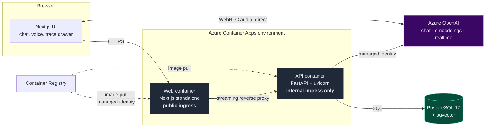
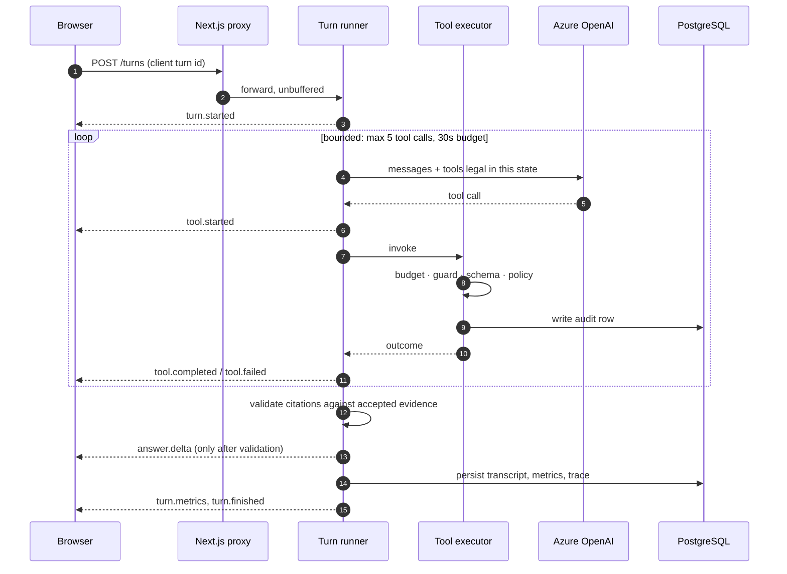
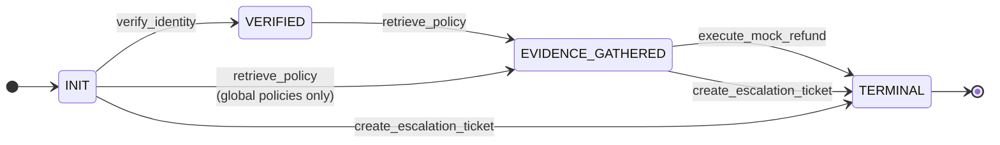
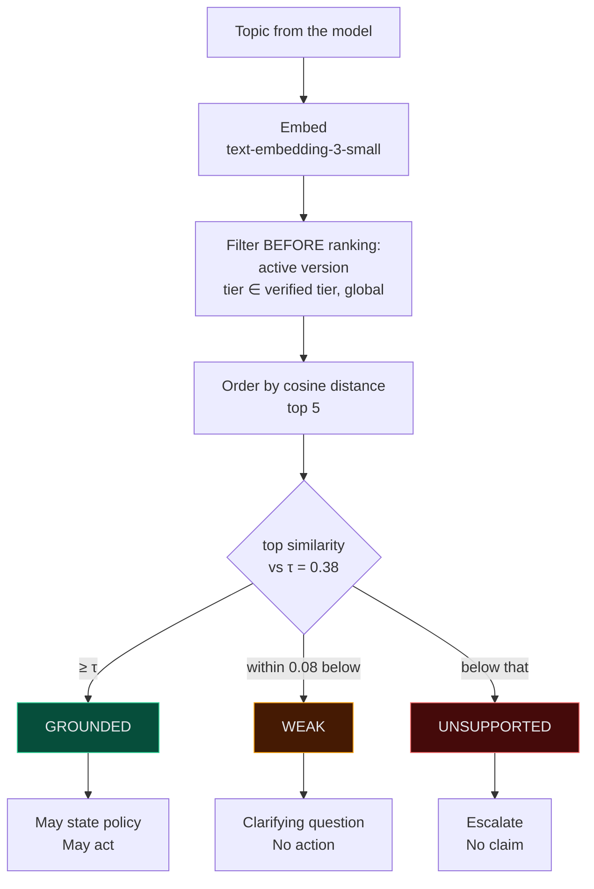
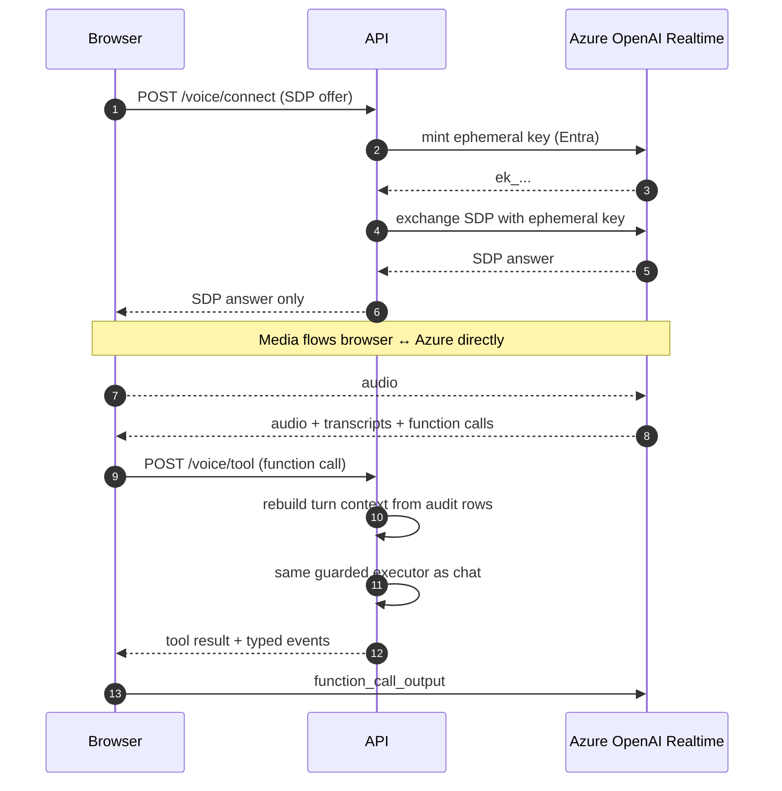
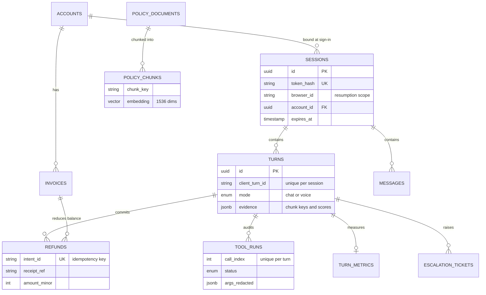
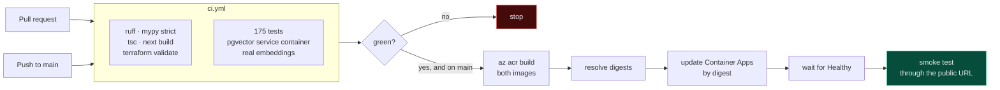

# Architecture

A customer support agent that takes a refund request by text or voice,
verifies who it is talking to, finds the governing policy, decides whether
that policy supports the request, and either issues the refund or refuses it
with the clause behind the refusal.

The design question throughout is not "can the model do this?" but **"what
happens when the model is wrong?"** Every guarantee below is enforced by the
runtime, never by asking the model nicely.

---

## 1. System

**The API is not publicly routable.** Its ingress is internal to the Container
Apps environment; the only way in is through the Next.js proxy. That proxy is
an explicit route handler rather than a `next.config` rewrite, because a
rewrite buffers Server-Sent Events and streaming is the product. It also
rewrites any upstream `Location` header back onto the public origin, so the
internal hostname cannot leak to a browser.

**Audio does not pass through the backend.** Only the WebRTC session setup
does — see §5.

No provider key exists anywhere in configuration. Both containers authenticate
to Azure OpenAI with a user-assigned managed identity.

---

## 2. A text turn, end to end

**The answer is buffered, not token-streamed.** Citations are validated
against the retrieved evidence before any text is released, and a token cannot
be un-said. Early feedback comes from tool status events instead, which arrive
in roughly 400 ms — sooner than a first token would, and more informative.

Each event is a typed, versioned, discriminated union (Pydantic on the server,
a hand-written mirror in TypeScript) carrying a monotonic per-turn sequence
number. The browser reducer drops a non-monotonic frame and flags it rather
than applying it.

---

## 3. Tool ordering is a state machine

The model may *request* anything. `ToolExecutor` checks the transition table
before dispatching, so a refund as the first call is refused by the runtime
with `tool_not_allowed`.

The voice path cannot narrow the tool list per state — a realtime session's
tools are fixed when it is minted — so it is advertised all four and relies on
exactly the same executor. Same guarantee, arrived at differently.

Two invariants live here because prompting could not hold them:

- **Authority is re-read from the database on every call.** Tier, contract
  status and invoice ownership never come from tool arguments, so a model that
  claims a higher tier in its arguments still gets the lower cap.
- **A ticket may not assert something the server did not do.** Asked for a
  refund above the tier cap, the model files an escalation with reason
  `action_blocked` *before attempting anything* — a durable record of a refusal
  that never happened. The executor rejects that claim unless a refusal is
  already recorded in the turn. The rejection is retryable, so the model's own
  recovery is to attempt the action, collect a real citable denial, and then
  escalate truthfully.

---

## 4. Retrieval and the grounding gate

Filtering before ranking is what makes tier leakage structurally impossible
rather than statistically unlikely. Similarity is stated as
`1 - cosine_distance` everywhere, in code and in the UI, because the number
means nothing without that sentence.

**Chunking** is heading-aware, with a ~300 token soft target and ≤50 token
overlap applied only when a section overflows; short sections stay whole.
Eligibility rules are kept with their exceptions, because a chunk stating a
rule without its carve-out is worse than no chunk. Chunk ids derive from
`(policy_version, normalised_text)`, so reindexing is deterministic and a
citation survives a rebuild.

**Citations are validated before any text is released.** An answer citing
anything outside the accepted evidence is withheld. The model never handles a
chunk key — it cites short ordinal refs that the server resolves against this
turn's evidence, because asking a model to transcribe a 12-hex-digit hash
produced a one-character error on roughly one turn in four, and the guard
correctly refused a well-grounded answer every time.

**τ is calibrated, not guessed.** `python -m support.retrieval.calibrate`
sweeps threshold × margin over a labelled query set and reports the trade-off.
At τ = 0.38 / margin 0.08: authoritative document present in the retrieved
evidence 21/21, out-of-scope rejected 6/6, zero wrong-tier and zero superseded
documents retrieved. Ties were broken toward the stricter threshold — an
unsupported policy claim is a worse failure than an unnecessary clarifying
question.

---

## 5. Voice

**The ephemeral key never reaches the browser.** It is a bearer credential for
our own Azure resource — anyone holding one could open their own session
against it, with their own instructions, billed to us. The server mints it,
spends it on the SDP exchange, and returns only the answer. An SDP answer is
not a credential and cannot be replayed. Media still flows directly, so this
costs one request at setup and nothing per utterance.

**A voice turn spans many requests.** Each function call arrives as its own
POST, seconds apart, possibly across a reconnect — so the guard chain cannot
live in process memory. It is derived from what was durably recorded: agent
state replayed from the turn's `tool_runs` through the same transition table,
identity re-resolved from the session binding, and evidence rehydrated from a
`turns.evidence` column holding chunk keys and scores only, with text re-read
from the corpus so a turn cannot cite a stale copy.

Server-side VAD with `interrupt_response` handles barge-in. A reconnecting
client asks `/voice/state` and adopts the in-flight turn rather than silently
restarting with a refund half-done.

---

## 6. Data model

Three constraints carry the weight:

| Constraint | What it prevents |
|---|---|
| `refunds.intent_id` unique | Double-spending under concurrency |
| `tool_runs (turn_id, call_index)` unique | An audit trail that silently loses an attempt |
| `turns (session_id, client_turn_id)` unique | A retried submit running the action twice |

**A refund claims its intent atomically** — `INSERT … ON CONFLICT DO NOTHING
RETURNING id` — and the balance moves only after the claim succeeds. A caller
learns whether it won *before* touching money, so losing costs nothing and
needs no recovery. The alternative, inserting optimistically and catching the
constraint violation, cannot work: once PostgreSQL raises, the transaction is
aborted and the lookup meant to recover the winner's receipt fails too.

**The receipt row is the record of a refund, not the tool's return value.** If
a refund commits and the call reporting it then fails, the turn reconciles
from the row before composing a reply and reports the money as moved.

---

## 7. Observability

Every turn records a trace, read back from the server's audit rows rather than
from the browser's event log — so a frame dropped on the way to the UI still
shows the tool call that ran.

- **Prompt trace**, one entry per model call: the tools legal in that state,
  every message as the model received it (previewed, not stored whole), and
  what came back. Per call, because a tool-using loop's input grows — the
  second call carries the first call's result, the call that answers carries
  the policy evidence.
- **Waterfall** on the turn's own clock. Bars are *positioned*, not stacked,
  because the gaps are model latency and they dominate: on a typical turn,
  3.3 s of 3.9 s is the model, not the tools.
- **Grounding** drawn as the actual decision rule, with the threshold *that
  decision* was taken under rather than whatever is configured now.
- **Tokens and cost**, labelled an estimate with the rate card's effective
  date. Cost is priced from configuration, never from billed usage.

Measured on the deployment over seven turns: turn total p50 **3.16 s**, time
to first tool status p50 **473 ms**. Both p95 figures come from the first turn
after a revision starts, which pays for credential acquisition and connection
setup.

---

## 8. Failure handling

| Failure | Behaviour |
|---|---|
| Model timeout or 429 | Bounded retry, then a named error and a retry control |
| Retrieval unavailable | No policy claim, no action; the turn still finishes |
| Tool failure | Refused in the open; the model may escalate |
| Lost confirmation after commit | Receipt recovered from the row, reported as recovered |
| SSE disconnect or refresh | Snapshot reload; a re-submitted turn replays instead of re-running |
| Microphone denied or call dropped | Explained in place, text keeps working, reconnect adopts the in-flight turn |

Retries are bounded twice over: by attempt count, and by whether the backoff
leaves enough of the turn budget for the retry to finish. A 30-second
`Retry-After` inside a 30-second budget is not slept through — the caller
would get the same failure later, and the sleep would burn the time the retry
needed.

Vendor exceptions are classified at the adapter boundary into three facts:
retryable, how long to wait, what the user may be told. An unrecognised
exception is **not** retryable, because a loop that cannot classify a failure
should not assume it is temporary.

---

## 9. Sessions

A session is bound to an account server-side at sign-in. Nothing said in a
message can change that binding, which is why a cross-account request fails in
the runtime rather than relying on the model to refuse.

Resumption is scoped to the **browser**, via an opaque, long-lived httpOnly
cookie recorded on each session row — never to the account, which is a
selectable identity and proves nothing. A different browser, machine or
private window is offered nothing, cannot inherit a session by selecting the
same account, and gets a 404 reading one directly even if it holds the id.

Resuming hands no token to JavaScript: the client calls the normal endpoints
with the httpOnly cookie, which the authoriser already accepts. Explicit
header credentials take precedence over the ambient cookie, so a request
presenting a deliberate credential is never silently authorised as a different
session.

---

## 10. Delivery

**No stored credential.** Authentication is OIDC federation: GitHub mints a
short-lived token naming the repository and branch, and Entra exchanges it
only if the subject matches a federated credential. Two identities, because
the jobs need unrelated powers — CI holds inference access and nothing else;
deploy can push images and update the two apps but cannot call the model, so a
compromised deploy job cannot spend quota. The deploy credential is bound to
the default branch, so a pull request from a fork can never assume it.

**Deployment is by digest, not by tag.** A tag can be moved; a digest names
the bytes that passed CI.

The smoke test drives a real request through the proxy, the internal API, the
database, retrieval and the model. A revision that starts but cannot answer a
question has not deployed, and a health endpoint would not notice.

Infrastructure is a single Terraform root — every Azure resource, including
the OIDC identities — and deliberately ignores the container image tag:
infrastructure is `terraform apply`, code is a pipeline concern. Mixing them
turns every code change into a plan review.

---

## 11. Design decisions

**No Kubernetes.** AKS means a control plane to patch, an ingress controller
to configure and node pools to size, for two stateless containers. Container
Apps gives managed TLS, scale-to-zero, revision-based rollout and an
internal-only ingress out of the box. The cost is less control over networking
and no sidecar story; neither is load-bearing here.

**No Redis.** The only shared state is sessions and turns, and both are
already in PostgreSQL, where the refund has to be transactional anyway. Redis
would buy a faster rate limiter and cross-replica state, at the price of a
second thing to run and a second source of truth about who is verified. The
rate limiter is therefore an in-process token bucket, which is **correct only
at one replica** — stated plainly rather than hidden.

**Single replica**, for that reason. Scaling out needs the buckets moved to
PostgreSQL or Redis first; nothing else in the design assumes one process.
Session state is durable and the guard chain is rebuilt from audit rows, so
both survive a replica restart mid-turn.

**Exact vector search, no HNSW index.** The corpus is tens of chunks. An
approximate index would add build time, a tuning surface and recall risk to a
sequential scan that takes under 400 ms in-region. The time for HNSW is when
the corpus is measured to need it.

**Hand-written TypeScript mirror of the Python event contract.** Generating a
discriminated union from Pydantic's JSON Schema needs enough post-processing
that the generator becomes its own thing to maintain. The trade is only safe
if drift is caught mechanically, so a parity test compares event names, enum
members **and payload field names** between the two.

**Policy prose and policy enforcement are separate sources.** Markdown is what
the customer is shown; a structured ruleset is what the server enforces. A
test asserts the two agree, so a cap cannot change in prose without changing
enforcement, or vice versa.

---

## 12. Known limitations

- **Microphone capture, speech transcription and barge-in are not verified
  end to end.** The WebRTC path, the denied-microphone path and the tool chain
  were exercised with a synthetic audio track; server-side VAD with
  `interrupt_response` is confirmed present in the minted session and the
  client handles the interrupt events, but real speech is needed to prove it.
- **An escalation ticket's `reason` can still be untrue.** The executor
  enforces the one case it can check — `action_blocked` requires a recorded
  refusal earlier in the same turn — but a model switching to `user_requested`
  asserts something no server state contradicts.
- **The in-process rate limiter is correct at one replica.**
- **No end-user authentication.** Identity is a bound account, and session
  isolation is enforced and tested, but there are no real user credentials.
- **Percentiles over a handful of turns** are the maximum wearing a
  statistic's name; sample counts are printed alongside for that reason.
