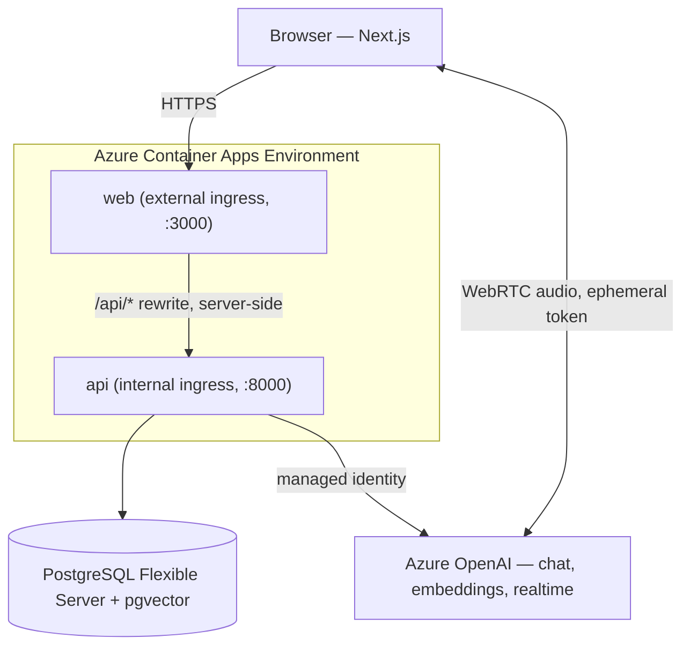
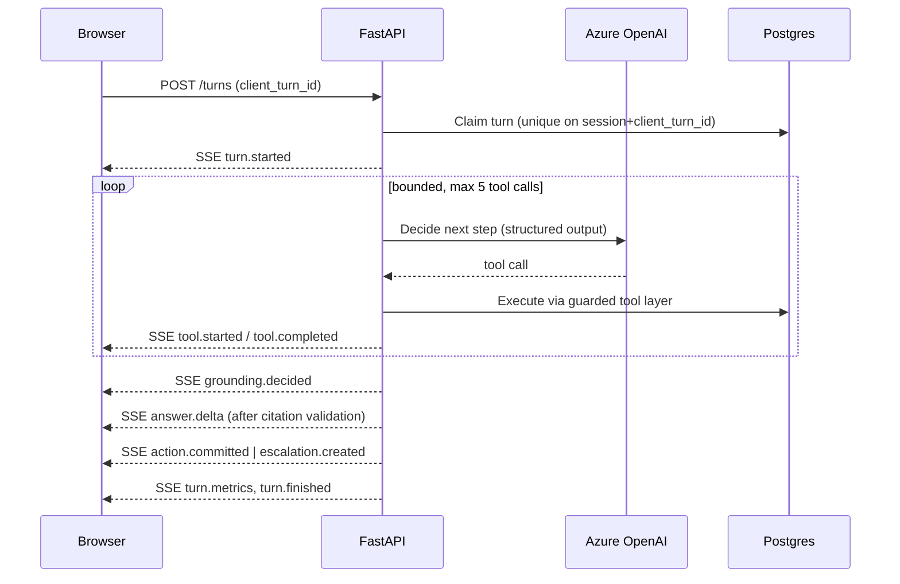
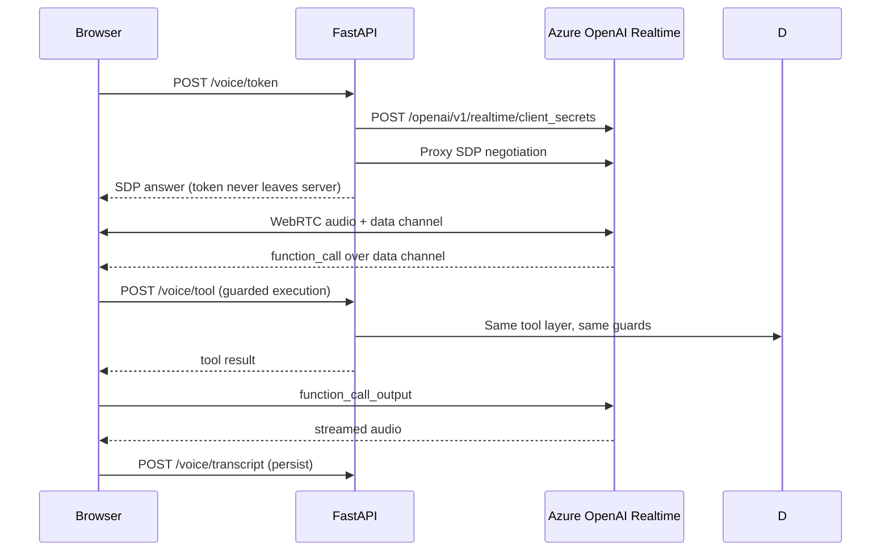

# Customer Support AI Agent — Build Plan

**Status:** awaiting sign-off
**Supersedes:** sections 12–20 of `customer-support-ai-agent-requirements.md`
**Source of truth for requirements:** `email.md`

---

## 1. What we are building

A fullstack customer support agent with streaming chat and live voice, a three-tool
orchestration chain with server-enforced ordering, pgvector RAG with an explicit
confidence threshold, and an observability drawer. Deployed to a public HTTPS URL
on Azure.

### Rubric alignment

| Weight | Category | What earns it here |
|---|---|---|
| 35% | Agentic architecture & tool orchestration | Typed state machine, guards enforced in the tool layer (not the prompt), grounding gate before any action, citation validation, intent-ID idempotency |
| 25% | Voice & real-time streaming UX | WebRTC to Azure OpenAI Realtime, waveform, live partial/final transcripts, barge-in, shared history across modes |
| 25% | Code quality & system design | Clean module boundaries, Pydantic v2 + TypeScript types, provider adapters behind interfaces, focused tests, Terraform IaC |
| 15% | Production readiness | Rate limiting, bounded retries, fault injection, graceful error UI, stable deployment, clear Loom |

### Explicitly out of scope

AKS, Kubernetes manifests, Helm, Envoy, cert-manager, private endpoints, private
build runners, Redis, OpenTelemetry Collector, managed Prometheus, k6 load tests,
multi-replica turn leases and fencing epochs, cross-pod reconcilers.

Each is justified in §12. These are documented trade-offs in the README, not gaps.

---

## 2. Locked decisions

| # | Decision | Rationale |
|---|---|---|
| D1 | Azure for everything | Only platform covering compute + Postgres + chat + embeddings + realtime voice under the $200 credit |
| D2 | Azure Container Apps, not AKS | Managed HTTPS FQDN with no domain purchase. `getUserMedia` requires a secure context, so a bare LoadBalancer IP would block the microphone entirely |
| D3 | `min-replicas: 1`, `max-replicas: 1` | No cold start for the reviewer; single replica removes the entire distributed-coordination problem honestly |
| D4 | Voice via Azure OpenAI Realtime over WebRTC | Native server VAD, barge-in, incremental audio. Removes ~800 lines of PCM framing, resampling, and onset detection |
| D5 | Audio goes browser ↔ Azure direct | Lowest latency; never traverses our ingress. Ephemeral token minted server-side, SDP negotiation proxied so the browser never holds a credential |
| D6 | Tool-ordering guards live in the tool executor | Both the chat loop and the Realtime function-calling loop get identical enforcement. Server state is authoritative; the model cannot reorder or forge |
| D7 | Single public origin | API ingress internal; Next.js rewrites proxy `/api/*` server-side. No CORS, no cross-site cookie problems |
| D8 | Terraform, single root, `azurerm` only | IaC without the four-root AKS machinery. ~200 lines |
| D9 | Terraform ignores the image tag | `terraform apply` for infra, `az containerapp update` for code. Keeps the inner loop at ~30s |
| D10 | Managed identity for Azure OpenAI | No API key in app config. Ten lines of Terraform, real production-readiness signal |
| D11 | **Every Azure resource is created by Terraform. No manual creation, no `import` of hand-made resources** | A clean `apply` from zero proves the config actually works; imported state can hide config bugs. Local state keeps this true with no bootstrap exception |

### Verified environment (2026-11-19)

Provisioned and functionally tested, not just listed:

| Item | Value |
|---|---|
| Subscription | Visual Studio Enterprise (id in `terraform.tfvars`, gitignored) |
| Resource group | `rg-support-agent` (East US 2) |
| AI Services account | `aoai-support-agent-hk` |
| OpenAI endpoint | `https://aoai-support-agent-hk.openai.azure.com/` |
| Voice deployment | `gpt-realtime-mini` → `gpt-realtime-2.1-mini` 2026-07-07, GlobalStandard, 5k |
| Chat deployment | `gpt-chat` → `gpt-4.1-mini` 2025-04-14, GlobalStandard, 30k |
| Embeddings | `text-embedding-3-small` v1, GlobalStandard, 30k |

`POST /openai/v1/realtime/client_secrets` returned **HTTP 200** with an `ek_…`
ephemeral token and an `expires_at` field. The WebRTC voice path (D4/D5) is
confirmed available on this subscription.

> The CLI-created originals were destroyed and purged. Everything below was
> created by `terraform apply` from zero (18 resources), per D11.

### Live infrastructure, measured

| Check | Result |
|---|---|
| `demo_url` | `https://ca-web-supportagent-hk.wittyflower-26f62e18.eastus2.azurecontainerapps.io` |
| HTTPS + managed-identity ACR pull | 200, TTFB 170 ms |
| **SSE through real ingress** | **Streamed, not buffered** — 5 events 1 s apart arrived +0.00/0.63/1.63/2.63/3.63 s |
| PostgreSQL | 16.15, `centralus` |
| pgvector | v0.8.7, `<=>` cosine operator verified |
| `terraform plan` | Clean, no drift |

### Calibration results (2026-11-19, for the README)

Swept threshold × margin over 30 labelled queries in `fixtures/eval/queries.json`.
Selected **τ = 0.38, weak margin = 0.08**.

| Metric | Result |
|---|---|
| Authoritative doc in evidence set (recall@k) | 21/21 = **100%** |
| Out-of-scope queries rejected | 6/6 = **100%** |
| Ambiguous queries handled acceptably | 3/3 = **100%** |
| Supported queries accepted | 18/21 = 86% |
| Wrong-tier documents retrieved | **0** |
| Superseded versions retrieved | **0** |
| Authoritative doc ranked first (top-1) | 16/21 = 76% |

Ties were broken toward the stricter threshold: an unsupported policy claim is
a worse failure than an unnecessary clarifying question. The three residual
misses are colloquial paraphrases carrying no policy vocabulary
("how much can I get back without talking to a manager", 0.336) which land in
WEAK and produce a clarifying question — an acceptable outcome, not a wrong
answer. Held-out recall is 1/3, but that subset is 3 queries of which 2 are the
same phrasing, so it is reported rather than treated as a reliable estimate.

The five top-1 misses are genuine semantic overlaps (a duplicate-charge
question really is billing-adjacent). Since the agent reads every accepted
chunk, recall@k is the metric that governs grounding; top-1 is reported as a
precision signal only.

### Infrastructure gotchas found (for the README trade-offs section)

1. **Postgres region split.** This subscription is barred from provisioning
   Flexible Server in eastus2/eastus/westus2/southcentralus/westeurope — a
   Visual Studio subscription geography limit, not quota. Postgres sits in
   `centralus`, ~20–25 ms from the apps.
2. **Container Apps ingress `transport`.** `"auto"` lets ACA negotiate h2c to
   the container, which hangs against HTTP/1.1-only servers (uvicorn/h11,
   Next.js standalone). Both apps pin `transport = "http"`. Symptom was a
   healthy replica serving nothing, then a 504 at the 240 s idle timeout.
3. **`Microsoft.App` not registered** by default; handled in-provider via
   `resource_providers_to_register`.
4. **Implicit Consumption workload profile** must be declared or every
   `terraform plan` shows phantom drift.

### Assumptions (correct me if wrong)

- ~~A1 — Fallback if realtime quota is refused~~ — **not needed.** Realtime quota
  granted and verified. Retained only as a contingency if capacity is withdrawn.
- A2 — Terraform state is local initially, with a commented `backend "azurerm"` block.
- ~~A3 — CI runs lint/typecheck/test only. Deployment stays manual via `az`.~~
  **Superseded.** Neither half was built during blocks 0–8; there was no
  `.github/` directory at all, which made the manual `az` loop the only
  deploy path rather than a deliberate choice. Block 9 builds both: CI
  including the full suite, and auto-deploy on `main` by image digest.
- A4 — Simulated action is a mock refund, plus a structured escalation ticket as the
  low-confidence terminal state. No account-field updates.

---

## 3. Open risks

| Risk | Impact | Branch |
|---|---|---|
| ~~Realtime model quota on a VS Enterprise subscription~~ | — | **RESOLVED** 2026-11-19: deployed, token minted, HTTP 200 |
| ~~`gpt-4.1-mini` unavailable in region~~ | — | **RESOLVED**: deployed as `gpt-chat` |
| SSE buffered by Container Apps ingress | Blocks chat streaming | Verified in Block 0 before any app code |
| Azure OpenAI regional capacity for embeddings | Low | Swap region or model version |

Container Apps ingress enforces a 4-minute **idle** timeout. Our chat turn budget is
30s and SSE sends heartbeat comments, so we are well clear. Voice is unaffected
(WebRTC bypasses ingress).

---

## 4. Architecture



The only public surface is the `web` app. The API is reachable only inside the
Container Apps environment.

### Chat turn



### Voice turn



---

## 5. Repository layout

```
apps/
  api/
    support/
      agent/          state machine, turn runner, prompts
      tools/          verify_identity, retrieve_policy, execute_mock_refund,
                      create_escalation_ticket + the guard layer
      retrieval/      chunking, ingestion, search, grounding decision
      providers/      azure_openai.py, realtime.py  (behind protocols)
      storage/        SQLAlchemy models, repositories, migrations
      api/            routes, SSE, event envelope, rate limit, fault injection
      config.py       pydantic-settings
    tests/
    alembic/
    Dockerfile
  web/
    app/              App Router pages
    components/       transcript, tool status, drawer, waveform, mic controls
    lib/              SSE client, WebRTC client, typed event reducer
    types/            generated from Pydantic JSON Schema
    Dockerfile
fixtures/
  policies/           versioned markdown
  accounts.json       seeded demo accounts + invoices
  eval/queries.json   labeled grounding evaluation set
infra/                Terraform, single root
scripts/              azure-teardown.ps1, seed, ingest
.github/workflows/    ci.yml
```

---

## 6. Data model

| Table | Key columns | Notes |
|---|---|---|
| `sessions` | id, demo_account_id, created_at, expires_at | Account bound server-side only |
| `demo_accounts` | id, name, tier, contract_status | Premium/active, Basic/active, Premium/inactive |
| `invoices` | id, account_id, amount_minor, refunded_minor, currency | Integer minor units |
| `turns` | id, session_id, client_turn_id, mode, status, outcome | **unique(session_id, client_turn_id)** |
| `messages` | id, session_id, turn_id, role, content, interrupted | Shared by chat + voice |
| `tool_runs` | id, turn_id, tool, args_redacted, status, ms | Feeds the drawer |
| `refunds` | id, intent_id, invoice_id, amount_minor, policy_version | **unique(intent_id)** |
| `escalation_tickets` | id, intent_id, session_id, reason_code, summary | **unique(intent_id)** |
| `policy_documents` | id, title, version, effective, tiers[] | Superseded versions excluded from search |
| `policy_chunks` | id, doc_id, heading_path, text, embedding `vector(1536)` | |
| `turn_metrics` | turn_id, ttft_ms, total_ms, tokens_in/out, cost_estimate | |

Alembic for migrations. Postgres 16.

---

## 7. Policy corpus, chunking, retrieval

**Corpus** — 6–8 short versioned Markdown documents:
refund policy Premium ($25 cap), refund policy Basic ($10 cap), contract
eligibility, two troubleshooting guides (global), one superseded refund version.
Held out entirely: shipping hardware to a new address → must be unsupported.

**Chunking** — heading-aware via `markdown-it-py`. Soft target ~300 tokens,
≤50 token overlap only when a section overflows. Short sections stay intact.
Eligibility rules kept with their exceptions. Chunk ID derived from
`(policy_version, normalized_text)` so reindexing is deterministic.

**Retrieval** — filter first on active version, then tier ∈ {verified tier, global};
then order by cosine distance, top 5. Exact search — the corpus is a few hundred
rows, so HNSW is unjustified and we say so in the README.
Similarity is `1 - distance`, stated explicitly in code and docs.

**Grounding decision** — threshold τ calibrated on `fixtures/eval/queries.json`
(~25 labeled queries: supported paraphrases, tier-overlap pairs, near-threshold
ambiguity, conflicting rules, clear out-of-scope). Outcomes:

- `GROUNDED` → answer with citations
- `WEAK` → targeted clarifying question
- `UNSUPPORTED` → escalation ticket

Policy claims and all actions require `GROUNDED`. Citations are validated against
accepted chunk IDs **before** any answer text is streamed. README reports τ,
acceptance rate on supported queries, and rejection rate on unsupported ones.

---

## 8. Agent and tools

```
INIT ──verify_identity──> VERIFIED ──retrieve_policy──> EVIDENCE
                                                           │
                        ┌──────────────────────────────────┤
                        ▼                                  ▼
              execute_mock_refund              create_escalation_ticket
                        │                                  │
                        └──────────> TERMINAL <────────────┘
```

Guards enforced in the executor against database state, never in the prompt:

- `verify_identity` — resolves the account **bound to the session by the UI sign-in
  control**. Takes no model-supplied secret, so the verification code never enters
  model context or traces. A chat message claiming a tier is ignored.
- `retrieve_policy(topic)` — tier read from server state, not from arguments.
  Returns chunks, source refs, grounding decision.
- `execute_mock_refund(invoice_id, amount_minor)` — validates account authorization,
  invoice ownership, currency, remaining refundable balance, contract status, and
  the active policy cap, all inside one transaction. Rejects if state ≠ EVIDENCE
  or grounding ≠ GROUNDED.
- `create_escalation_ticket(reason_code)` — structured, never an invented ID.

**Idempotency** — `intent_id = hash(session_id, invoice_id, amount_minor, client_turn_id)`.
Unique constraint on `refunds.intent_id`. Lookup by intent before any retry. Session
row locked, then invoice row, consistent order. A new explicitly-requested partial
refund gets a new intent. Never report success without a persisted receipt.

**Bounds** — max 5 tool calls per turn, per-tool timeouts, 30s turn budget. Budget
exhaustion ends with a useful message, not a hang.

---

## 9. Event contract

Envelope: `{ version, session_id, turn_id, seq, type, ts, payload }`, `seq`
monotonic per turn.

Types: `turn.started`, `transcript.partial`, `transcript.final`, `tool.started`,
`tool.completed`, `tool.failed`, `grounding.decided`, `answer.delta`,
`action.committed`, `escalation.created`, `turn.metrics`, `turn.finished`.

Pydantic v2 models are the source of truth → JSON Schema → TypeScript types in CI.
The web client renders from a typed reducer keyed by turn ID.

---

## 10. Endpoints

| Method | Path | Purpose |
|---|---|---|
| POST | `/api/sessions` | Create session, bind demo account, set HttpOnly cookie |
| GET | `/api/sessions/{id}` | History, active turn, receipts, tickets |
| POST | `/api/sessions/{id}/turns` | Chat turn → SSE |
| POST | `/api/sessions/{id}/turns/{tid}/cancel` | Idempotent cancel |
| GET | `/api/sessions/{id}/turns/{tid}/trace` | Redacted drawer projection: tool rows, waterfall offsets, and the threshold the decision was actually taken under |
| GET | `/api/sessions/{id}/metrics` | Session rollup. Latency split by mode, percentiles reported with their sample count |
| POST | `/api/sessions/{id}/voice/connect` | SDP proxy; mints and spends the ephemeral secret server-side, so the browser never holds one. Named `/voice/token` in the original draft, which was misleading: it returns an SDP answer, never a token |
| POST | `/api/sessions/{id}/voice/tool` | Guarded tool execution from Realtime |
| POST | `/api/sessions/{id}/voice/transcript` | Persist transcripts |
| GET | `/api/sessions/{id}/voice/state` | Rebuilt agent state for an in-flight voice turn, for reconnects |
| POST | `/api/sessions/{id}/reset` | Reset demo fixtures for this session |
| POST | `/api/sessions/{id}/fault` | Demo-only fault injection, own session only. All five kinds implemented and covered by a test that parametrises over the enum |
| GET | `/healthz`, `/readyz` | No billable provider calls |

Session credential is an opaque token in a Secure, HttpOnly, SameSite=Lax cookie —
viable because D7 gives us a single origin.

---

## 11. Observability, resilience, security

**Drawer** — per-turn waterfall (verification → retrieval → generation → action),
end-to-end latency, time to first token/audio, redacted prompt excerpt, model name,
tool transitions, similarity scores vs threshold, token counts, estimated cost from
a config price table with an effective date. Cost labeled an estimate; missing usage
labeled unavailable. Never logged: credentials, verification codes, raw audio,
hidden reasoning.

**Failure handling**

| Failure | Behavior |
|---|---|
| LLM timeout / 429 | Bounded retry inside turn deadline — capped by attempts *and* by whether the backoff leaves working time — then a named error and a retry control |
| Retrieval unavailable | Block policy claims and actions, offer escalation, keep history |
| Action timeout after possible commit | Reconcile from the receipt row inside the same turn and report it as recovered. No pending state: see §14d for why resolving beats showing an unknown |
| Mic denied / voice disconnect | Explain in place, offer chat in same session, allow reconnect |
| SSE disconnect / refresh | Reload persisted state, no duplicate turn |

**Limits** — in-process token buckets per session and per IP (valid at one replica),
capped request size, 30s turn budget, capped voice session duration, 429 with
`Retry-After`.

**Security** — provider credentials server-side only, managed identity to Azure
OpenAI, API not publicly routable, retrieved content and user input treated as
untrusted data, tier and permissions never taken from model arguments, non-root
containers.

---

## 12. Infrastructure

Single Terraform root, `azurerm ~> 4.0`, `terraform >= 1.9`.

```
infra/main.tf        providers, resource group, features block
     /ai.tf          AI Services account + 3 cognitive deployments
     /data.tf        Postgres Flexible Server, database,
                     azure.extensions = VECTOR
     /apps.tf        ACR, Container Apps environment, web + api apps
     /identity.tf    user-assigned identity, AcrPull + Cognitive Services
                     OpenAI User role assignments
     /variables.tf   region, prefix, model names/versions, replicas
     /outputs.tf     web FQDN, postgres FQDN, ACR login server
```

```hcl
features {
  cognitive_account { purge_soft_delete_on_destroy = true }
}

lifecycle {
  ignore_changes = [template[0].container[0].image]
}
```

**Deploy loop**

```
az acr build --registry <acr> --image api:<sha> ./apps/api
az containerapp update -n api -g rg-support-agent --image <acr>.azurecr.io/api:<sha>
```

**Teardown** — `terraform destroy` (purges soft-deleted AI accounts via the feature
flag), with `scripts/azure-teardown.ps1` retained as the safety net and for
`-Mode Stop` / `-Mode Start` between rehearsals.

---

## 13. Testing

| Suite | Covers |
|---|---|
| pytest — state machine | Every guard: out-of-order rejection, unverified access, tier mismatch, inactive contract, cap exceeded |
| pytest — grounding | τ against the labeled set; supported accepted, out-of-scope rejected |
| pytest — Postgres integration | Concurrent same-intent refund writes produce one receipt; balance correctness |
| pytest — SSE | Event ordering, sequence monotonicity, cancellation, deterministic provider fakes |
| vitest | Typed event reducer, interruption state |
| CI | ruff, mypy, pytest, tsc, vitest, docker build, contract drift check |

No Playwright, no k6. Manual browser smoke test with real speech before recording.

---

## 14. Work blocks

Dependencies in brackets. Blocks 1–2 can run while Block 0 is being verified.

| # | Block | Exit criterion |
|---|---|---|
| 0a | ~~Azure + model verification~~ | **DONE** — see §2 Verified environment |
| 0b | Terraform written, validated | **DONE** — `fmt` clean, `init` + `validate` pass, azurerm 4.81.0 pinned |
| 0c | Purge CLI-made resources, `terraform apply` from zero | **DONE** — 18 resources via Terraform, plan clean, HTTPS live, SSE verified unbuffered, pgvector 0.8.7 working |
| 1 | Repo scaffold, contracts, schema, migrations, fixtures | **DONE** — 11 tables migrated, reversible, zero autogenerate drift; 3 accounts + 4 invoices seeded idempotently; ruff + mypy strict clean |
| 2 | Corpus, chunking, ingestion, retrieval, τ calibration [1] | **DONE** — 7 docs / 40 chunks embedded; **τ=0.38, margin=0.08**; recall@k 100%, out-of-scope rejection 100%, zero tier leakage, zero superseded hits |
| 3 | Tool layer, state machine, guards, idempotency [1,2] | **DONE** — 51 tests green; concurrent same-intent commit yields exactly one receipt; out-of-order and unverified-escalation refunds both refused by the runtime |
| 4a | Chat turn runner + model-in-the-loop | **DONE** — all four demo paths verified against `gpt-4.1-mini`: refund committed, tier denial, contract denial, unsupported → escalation. Structured citations validated and carried on `turn.finished` |
| 4b | SSE endpoint, session routes, rate limiting | **DONE** — 70 tests green; full turn verified over HTTP; duplicate submit replays without re-running; cross-session read denied |
| 4c | Next.js chat UI, tool status, citations | **DONE** — 96 tests green; **deployed and verified on the live HTTPS URL**: account picker, live tool status, grounding chips, citations, receipt and denial cards, session restore on refresh. Four defects found and fixed along the way — see §14a |
| 5 | Voice: SDP proxy, WebRTC, waveform, barge-in [3,4] | **DONE** — 114 tests green; verified live against `gpt-realtime-mini`: WebRTC connected, all three tools run through the same guarded executor across separate requests, refund committed and spoken back. See §14b |
| 6 | Observability drawer, metrics, cost [4] | **DONE** — 133 tests green; per-turn drawer (waterfall on the turn clock, similarity against τ and the weak band, tokens, cost labelled an estimate, redacted tool rows) plus a session rollup with latency split by mode. Voice turns are traceable too: their metric row is derived from the audit rows. Using it found three real defects — a clock mixed between the database and the app, a one-in-four citation refusal on the headline policy question, and a turn labelled "Escalated" with no ticket. Warm p50 time-to-first-status **473 ms**, turn total **3.16 s**. See §14c |
| 7 | Fault injection, rate limits, error states, reconnect [4,5] | **DONE** — 165 tests green; all five failure rows verified on the deployment and in the browser. Provider errors are classified at the adapter and retried within the turn deadline; a refund that commits and then loses its confirmation is reconciled from the receipt row inside the same turn. Found a demo control that did nothing on chat, two unimplemented fault kinds, and a payload field the browser never heard about. See §14d |
| 8 | Deploy final, README, rehearse, record | **README, demo script and rehearsal DONE** — all six demo scenarios run against the deployment and recorded in §15; calibration re-run to confirm the published numbers; `.gitignore` completed for Node/Next/IDE. Outstanding and owner-only: the commit, a clean-browser pass with a working microphone, and the recording |
| 9 | CI/CD: pull-request gate and auto-deploy on main | **DONE** — two workflows, no stored credential. `ci.yml` runs lint, mypy strict, tsc, a Next.js production build, terraform validate, and all 166 tests against a pgvector service container with Azure OpenAI over OIDC. `deploy.yml` gates on that, builds both images in ACR, rolls out **by digest**, waits for Healthy, and smoke-tests the public URL. Identities, federated credentials and a three-action custom ACR role are in `infra/cicd.tf`. See §14e |

---

---

## 14a. What Block 4c turned up

Building the browser client meant driving the whole stack the way a user does,
which surfaced five things the API tests had not.

### 1. The grounding threshold was calibrated on the wrong distribution

τ=0.38 was calibrated against `fixtures/eval/queries.json`, which is 30
natural-language questions. In production the retrieval query is not the
customer's words — it is the `topic` argument the *model* writes, and the model
writes keywords.

Measured against the Premium refund corpus:

| Query | Top similarity | Decision | Chunks accepted |
|---|---|---|---|
| `refund double charge` (what the model actually sent) | 0.356 | **weak** | 0 |
| `double charge` | 0.305 | weak | 0 |
| `refund policy` | 0.504 | grounded | 5 |
| the customer's raw utterance | 0.382 | grounded | 1 |
| model topic + raw utterance appended | 0.405 | grounded | 2 |
| `Can I get a refund for a double charge on invoice INV-1001?` | 0.499 | grounded | 5 |
| `Is a double charge refundable, and what is the refund limit for my plan?` | 0.598 | grounded | 5 |

So a plainly on-topic refund request failed closed and escalated — and the
threshold was not at fault: every prose form of the same question clears it
comfortably.

**Fix:** constrain the tool contract so the model asks a question rather than
passing keywords (the `retrieve_policy` tool definition, the `RetrievePolicyArgs`
field docs, and a line in the system prompt). This moves production queries into
the distribution the threshold was calibrated on, instead of moving the
threshold to accommodate a query shape nobody measured. Verified after the
change: the model now sends *"Can I get a refund for a duplicate charge, and
what is the refund limit for my plan?"*, and retrieval returns 0.590 with 5
chunks accepted.

**Rejected:** deterministically appending the customer's utterance to the query.
It is the obvious fix and it does work, but at 0.405 with 2 chunks it is
strictly worse than a well-formed question, and it would re-introduce the same
mismatch between what is calibrated and what is sent.

### 2. Raw JSON reached the customer

With `response_format` set to a `strict: true` json_schema, the service
nonetheless returned **two complete JSON objects concatenated in one message**.
`json.loads` raised, `_parse_reply` fell through to its prose fallback, and the
literal `{"answer": ..., "cited_chunk_ids": [...]}` was streamed to the browser
as the reply — twice over.

**Fix:** `_parse_reply` now uses `json.JSONDecoder().raw_decode()`, which takes
the first complete value and ignores trailing bytes, and the prose fallback
strips any JSON wrapper rather than printing it. Eleven regression tests in
`tests/test_reply_parsing.py`, including the two-object case, truncated
envelopes, escaped quotes, and "unparseable JSON is withheld rather than shown".

### 3. `action.denied` was never emitted

`ActionDenied` existed twice: as an exception in `tools/errors.py` and as an
event in `contracts/events.py`. Only the exception was wired up, so every policy
refusal surfaced as a generic `tool.failed`, `TurnOutcome.POLICY_DENIAL` was
dead code, and the UI had no way to show *why* a refund was refused or which
clause said so. The errors module docstring already claimed the transport
produced "`tool.failed` / `action.denied`" — the intent was there, the wiring
was not.

**Fix:** the runner emits `action.denied` with the structured `DenialReason` and
the accepted evidence as citations, and sets `POLICY_DENIAL`. Verified live:
`insufficient_refundable_balance` and `invoice_not_owned` each render a denial
card with its policy basis.

### 4. The model files untrue escalation reasons

Given a $15.00 refund request against the $10.00 Basic cap, the model will not
call the refund tool. It escalates instead — and labels the ticket
`action_blocked`, a durable record asserting that an action was refused when no
action was ever attempted.

Three successive prompt revisions failed to change this: an explicit "do not
decide eligibility yourself, call the tool even when you expect a refusal" in
the system prompt, a matching line in the refund tool description, and finally a
direct "do NOT escalate a refund you expect to exceed a limit" in the escalation
tool description. After all three, it still escalated.

**Fix:** enforced in the executor, which is where this project puts invariants
prompting cannot hold. `action_blocked` now requires a refusal recorded earlier
in the same turn (`ctx.denials`); the rejection is retryable, so the model can
either attempt the refund and get a real, citable refusal, or escalate under a
reason that is true. Three tests in `tests/test_escalation_truthfulness.py`.

**Honest limitation:** the model responded by switching to `user_requested`,
which is also untrue — the customer did not ask for a human. The server can
check "was an action blocked" because it knows; it cannot check "did the
customer want a person" without brittle text matching, so that one is left
unenforced and documented rather than papered over. The tier-cap denial itself
is correct and covered by tests; it is reached live through the two denials the
model *cannot* pre-judge, because neither invoice ownership nor remaining
refundable balance appears anywhere in the policy text.

### 5. Citation validation fires intermittently, and said nothing useful

Roughly one turn in four on an otherwise well-grounded query, the model cites a
chunk id outside the accepted evidence. The guard does the right thing — it
withholds the answer and escalates rather than stating an unverifiable claim —
but the offending ids went nowhere, despite a code comment claiming they were
named. Only a count reached the customer, which is right for the customer and
useless for an operator.

**Fix:** the ids and the accepted set are logged server-side at WARNING. The
customer still sees only the count. The guard's strictness is deliberately
unchanged: one bad citation out of five fails the whole answer, because the
alternative is releasing a claim that may have leaned on the source that could
not be verified.

Those logs are what later identified the mis-copied hash behind a one-in-four
refusal, and they are why the model no longer handles chunk keys at all. Two
details above are superseded by §14c: the field is `cited_refs`, and a refused
answer is recorded as a recoverable failure rather than an escalation, since no
ticket is created.

### Deployment notes

Two failures worth recording, both invisible until the container actually ran:

* **`exec: "/app/entrypoint.sh": permission denied`.** The build context comes
  from a Windows checkout, which has no POSIX execute bit to carry across. The
  image built and pushed cleanly, then failed at container create with
  `ActivationFailed` and **no application logs at all**, because no process ever
  started. Fixed with an explicit `RUN chmod 0755` in the Dockerfile rather than
  relying on the host filesystem. Diagnosis needed `ContainerAppSystemLogs_CL`:
  `az containerapp logs show` returns only the currently-active revision, which
  was still the old placeholder.
* **The internal ingress 301s plain HTTP to its own HTTPS URL.** Terraform set
  `API_INTERNAL_URL` to `http://...internal...`; the proxy forwarded that
  redirect to the browser, pointing at a hostname that resolves only inside the
  environment. Every API call failed, and the internal FQDN leaked on the way
  out. Fixed by using `https://` — the environment certificate verifies from
  inside the container, confirmed with `az containerapp exec` — and the proxy
  now rewrites any upstream `Location` back onto the public origin, dropping it
  if it points anywhere else.

`az acr build` still dies on Windows with a colorama/cp1252 `UnicodeEncodeError`
while streaming build logs. The build itself succeeds server-side: use
`--no-logs` and poll `az acr task list-runs`.

---

---

## 14b. What Block 5 turned up

### The Realtime API had moved, and the docs were the cheap way to find out

The preview surface this project was planned against is gone. Probing the live
resource before writing any client:

| Endpoint | Auth | Result |
|---|---|---|
| `/openai/v1/realtime/client_secrets` | Entra bearer | **200**, `ek_…` + full session object |
| `/openai/v1/realtimertc?model=…` | either | 404 |
| `/openai/realtime?model=…` | either | 404 |
| `/openai/v1/realtime/calls` | **ephemeral** | **400 "Offer did not have an audio media section."** |
| `/openai/v1/realtime/calls` | Entra bearer | **401 "This operation requires ephemeral tokens for authentication."** |

The 400 is the useful one: a wrong URL 404s, so an error that complains about
*the offer* proves the endpoint was reached and is parsing the request. The
401 settles the auth model — the SDP exchange accepts only an ephemeral key,
never the resource credential.

That has a direct architectural consequence. The ephemeral key is a bearer
credential for our Azure resource: anyone holding one can open their own
realtime session against it, with their own instructions and tool list, billed
to us. So the SDP exchange is **proxied**: the browser posts an offer to
`/voice/connect`, the server mints a key, spends it, and returns only the
answer. An SDP answer is not a credential and cannot be replayed. Media still
flows browser-to-Azure directly, so this costs one request at setup and
nothing per utterance.

### A voice turn is many requests, so the guard chain had to become durable

This is the real design problem of the block, and it does not exist in chat.

A chat turn is one request: the runner holds `TurnContext` in memory for its
duration, and the state machine advances inside a single loop. A voice turn is
not one request — each function call from the realtime model arrives as its
own POST to `/voice/tool`, seconds apart, possibly across a reconnect. Held in
process, `ctx.evidence` would be `None` on every call after the first, and the
grounding gate would refuse every action on the voice path while every chat
test stayed green.

The context is therefore **derived from what was durably recorded**:

* **Agent state** is replayed from this turn's successful `tool_runs` through
  `guards.next_state` — the same transition table the live path uses, so there
  is no second definition of the ordering rules to keep in step.
* **Identity** is re-resolved through `verify_identity`, which reads the
  session's account binding, never anything the client sent.
* **Evidence** is rehydrated from a new `turns.evidence` column that stores
  chunk *keys and scores only*. Text is re-read from `policy_chunks` on load,
  so a turn cannot cite a stale copy of a re-ingested document, and a chunk
  that has since disappeared is dropped rather than resurrected — which can
  only make the gate stricter.

The audit trail is the state. A reconnecting browser resumes exactly where it
left off rather than silently restarting at INIT with a refund pending.

### A latent crash, found by thinking about what voice would do differently

The realtime session is advertised **all four tools**, because its tool list is
fixed at mint time while the agent state advances mid-conversation. Narrowing
per state, as the chat loop does, is not available; letting the executor refuse
the illegal ones is the same guarantee arrived at differently.

That made illegal calls routine rather than rare, which exposed a bug that had
been sitting in the executor the whole time: `calls_made` incremented only on
the success path, but an audit row is written for **every** attempt, and
`tool_runs` has `unique(turn_id, call_index)`. Two refused calls in one turn
therefore both claimed index N:

```
IntegrityError: duplicate key value violates unique constraint
"uq_tool_runs_turn_call"  DETAIL: Key (turn_id, call_index)=(…, 0) already exists.
```

A model making two illegal calls would take down the turn — precisely the
thing the guards exist to absorb. The index is now claimed before any check can
fail, which also means a refusal consumes budget: a realtime session, which has
no outer loop bounding it, cannot sit in a turn issuing illegal calls for free.
Covered by `tests/test_call_index.py`.

Worth noting the first version of that test was wrong, not the fix: it used
`create_escalation_ticket` as the second illegal call, which is legal from
INIT — a customer may ask for a human before verifying anything.

### Verified live, and what was not

Driven against the real `gpt-realtime-mini` deployment in the browser:

```
pc:connected → dc:open
tool:verify_identity     = 200  state=verified           tool.started, tool.completed, identity.verified
tool:retrieve_policy     = 200  state=evidence_gathered  tool.started, tool.completed, grounding.decided
tool:execute_mock_refund = 200  state=terminal           tool.started, tool.completed, action.committed
spoken: "All set. The duplicate charge refund for $15.00 on INV-1001 has been
         committed, and your receipt reference is RF-1DADF60D."
```

Three chained tool calls over the voice path, each through the same executor,
with state carried across three separate HTTP requests. The UI renders the
spoken turn with the same cards as a typed one — grounding chips, citations,
receipt — because the voice endpoint returns the same typed events the SSE
stream emits, into the same reducer.

The agent also read the reference back as `R F E 9 A 4 A 3 0 3`, separate
characters, which is the voice addendum doing its job.

**Done without a microphone, deliberately.** The browser's mic permission was
in `prompt` state, and a Chrome permission bubble cannot be dismissed
programmatically — triggering one would have left it hanging in the user's
browser. Instead:

* the SDP path was exercised with a `recvonly` audio transceiver, which
  produces a genuine offer with an audio m-line and needs no permission;
* the full client was then run unmodified against a **synthetic silent audio
  track** standing in for `getUserMedia`, with the spoken request injected as
  text over its own data channel;
* the denied-microphone path was exercised by stubbing `getUserMedia` to
  reject, which is a real failure mode: the UI shows "Voice unavailable" and
  keeps chat working rather than dead-ending.

So **microphone capture, speech transcription and barge-in are the parts not
yet exercised end to end.** Server-side VAD with `interrupt_response: true` is
confirmed present in the minted session, and the client handles
`input_audio_buffer.speech_started` by closing the current turn as interrupted
and opening a new one — but an actual interruption needs real speech, and it
belongs in the Loom rather than in a claim made here.

Teardown was checked explicitly: on hang-up the peer connection and data
channel close and the microphone track reaches `ended`, released rather than
merely muted. The session also closes itself at `max_voice_session_s`, because
a forgotten open microphone is both a cost and a privacy problem.

---

---

## 14c. What Block 6 turned up

### The waterfall found a clock bug on its first run

The drawer draws each tool call as a bar positioned on the turn's own clock,
so a step's offset plus its duration must land inside the turn. The first test
of that invariant failed by 320ms:

```
assert (7207 + 282) <= (7169 + 50)
```

The last tool call finished *after* the turn that contained it. Not a rendering
problem — a wrong number. `turns.started_at` and `tool_runs.started_at` are
Postgres defaults, so they are on the database's clock, while `finished_at` was
being set from `datetime.now(UTC)` in the API process. Subtracting one from the
other mixes two clocks, and a few hundred milliseconds of skew between the host
and the database container is entirely normal.

The span is now read from the same clock the offsets are on (`select now()` in
the closing request), and the test asserts the invariant with no tolerance at
all — a fudge factor there would have hidden the thing worth finding.

The chat path was never affected: it measures everything from one
`time.monotonic()` baseline inside a single request. The bug could only exist
on the voice path, because only there is the turn's duration derived from two
stored timestamps.

### Gaps, not bars

A stacked bar of tool durations would have been easier to draw and would have
quietly blamed the tools for the latency. On a measured turn:

| | |
|---|---|
| Total | 14.80 s |
| Time inside tools | 4.19 s |
| **Model and overhead** | **10.61 s** |

Seventy percent of the turn is the model deciding what to do next. So the bars
are *positioned* on the turn clock rather than packed end to end, the space
between them is named as model latency in the panel itself, and the remainder
is drawn as its own row. The one number a reviewer should take away from the
drawer is where the time actually goes, and it is not in the tool calls.

That table is from a local run, where retrieval goes over the open internet.
Measured on the deployment, over seven turns in one session:

| | p50 | p95 |
|---|---|---|
| Turn total | **3.16 s** | 6.94 s |
| Time to first tool status | **473 ms** | 4.47 s |

Both p95s are the same turn: the first one after a revision starts, which pays
for credential acquisition and connection setup. Warm, the first visible
progress is under half a second, which answers the sub-1s target in the brief
and also retires an earlier open question -- the 2.9-4.5 s figures recorded in
Block 4b were cold-start measurements that had never been separated from
steady state. In-region retrieval is the other half of the difference: the same
`retrieve_policy` call takes 386 ms in Azure against 3.76 s from a laptop.

### The drawer's first real use found a one-in-four failure

Five identical policy questions were run against the deployment to get a
latency sample. Four were answered. The fifth said:

> I couldn't confirm the policy sources for that, so I'd rather not guess. I
> can pass this to a billing specialist.

Its trace showed retrieval had *succeeded*: GROUNDED, five chunks, top
similarity 0.692. The server log named the cause exactly:

```
citation validation failed turn=fa75dc7f…
  invalid=['refund-policy-premium@2.0#02:d27aad6be70e3']
  accepted=[…, 'refund-policy-premium@2.0#02:d27aad6be70e', …]
```

One character. The model cited the right chunk and appended a `3` to a
12-hex-digit hash. The citation guard refused to release the answer, which is
correct and is the whole point of the guard — but the contract was asking the
model to transcribe a hash, and that is a transcription error waiting to
happen. Stated as a demo risk: **a reviewer asking the headline policy question
had about a one-in-four chance of being told the agent could not confirm its
sources.**

So the hash is gone from the model's side of the contract. Evidence is rendered
with short ordinal refs, the reply schema takes `cited_refs: integer[]`, and the
server resolves ordinals back to chunk keys from this turn's accepted evidence —
the same list, in the same order, that was rendered. The model never handles a
key and so cannot mis-copy one.

The guard keeps its teeth. A ref outside the range resolves to something that
cannot be a chunk key, so it is refused exactly as a fabricated id was, rather
than being dropped — dropping it would release a policy claim whose stated
source does not exist. Zero and negative refs are refused too: refs are
1-based, so `0` is not "the first chunk".

Six identical turns after the change: six grounded answers, no refusals.

### The worse half of that bug was the label

The refused turn was recorded with outcome `escalation`. No ticket row existed —
the reply *offers* a specialist, it does not reach one — so the UI showed an
"Escalated" chip with no ticket reference anywhere. That is the same false claim
the voice path was audited for earlier in this block, sitting in the chat path
the whole time.

It is now `recoverable_failure`, and the error event is marked retryable,
because asking again is genuinely the right advice: this is a per-reply slip,
not a property of the question.

Worth recording how close that fix came to being silently undone. A few lines
further on there is a generic relabelling step — "if the turn ended in a
recoverable failure but produced text, infer the real outcome from context" —
which reads the grounded evidence and returns `grounded_answer`. Left alone, it
would have relabelled the refusal as the exact claim that had just been
withheld. The refusal now sets a flag that step honours, and
`tests/test_citation_guard.py` asserts both halves: not an escalation, and not a
grounded answer either.

### A spoken turn had no metrics at all

Chat accumulates metrics in the runner as the turn streams. Voice has no
runner, so every voice turn would have opened the drawer on an empty panel —
the half of the demo that most needs evidence would have been the half with
none.

The metric row is now derived from the rows the tool calls already wrote, when
the closing transcript lands:

* **offsets** from each `tool_runs.started_at` relative to the turn, so voice
  and chat render through the same waterfall component;
* **grounding** from the rehydrated evidence, not from config;
* **outcome** inferred from what was recorded, which is deliberately *not* the
  chat path's inference. The chat version answers "what should happen next?"
  mid-stream; after the fact the only honest answer is what exists. An
  UNSUPPORTED decision with no ticket row is reported as a clarification, not
  an escalation — labelling a turn "Escalated" when no ticket exists would be a
  claim the database does not support.

Two fields stay empty on purpose. The realtime session reports token usage over
the audio data channel to the *browser*, not to this server, so there is nothing
measured to price. `$0.00` reads as "free"; the drawer shows "not estimated" and
says why. `total_ms` also means something different for a spoken turn — the span
includes the time the customer spent talking — so it is labelled "exchange span"
there and the rollup never pools the two modes into one median.

### Percentiles that admit their sample size

The rollup reports p50 and p95 over a handful of turns. Nearest-rank, no
interpolation, and every percentile is printed with its sample count: `p95
15.90 s (2)` is visibly the slower of two turns rather than a statistic. A
smooth interpolated number over four samples would be a guess wearing a
measurement's clothes, which is the exact failure the rest of this system is
built to avoid.

### A threshold is evidence, so it is recorded with the decision

The drawer draws the similarity scale with the UNSUPPORTED / WEAK / GROUNDED
bands in their real positions, which means it needs τ and the margin. Reading
them from config at render time would mean that retuning τ silently rewrites
the history of every decision taken under the old one.

They are now written into the turn's own trace detail at persist time. Rows
written before that fall back to the current config **and are flagged**, so a
fallback is visible rather than indistinguishable from a measurement.

### A test that was poisoning the next one

Not part of Block 6, but it surfaced here. Issuing a refund is a durable write.
Deleting the test's session cascades to the receipt, but nothing was putting
`invoices.refunded_minor` back — so a passing test left the fixture account
poorer, and the next test to request $15.00 against it failed with
`insufficient_refundable_balance`. That failure reads as a bug in the refund
guard, which is exactly the wrong place to go looking. Balance restoration now
lives in the shared teardown.

The shared ASGI client and the voice request helpers moved to `conftest.py` and
`tests/voice_requests.py` while fixing that, so the fix had one home rather
than two.

---

---

## 14d. What Block 7 turned up

### The demo control that did nothing

`POST /fault` wrote `sessions.injected_fault`, the voice path read it, and the
chat path never did: `TurnRunner` built its own `TurnContext` and left
`injected_fault` at its default. Every fault armed from a typed turn was
silently ignored — the one mode the control would most often be demonstrated
in. Fixed by reading the armed fault from the session row at the start of each
turn, which is also where it belongs: the fault is session state, not
something a caller passes in.

Two of the five kinds had never been implemented at all. `llm_timeout` and
`rate_limit` existed as enum members and nothing else. `tests/test_resilience.py`
now parametrises over `FaultKind` itself and asserts each one produces a
visible effect, so a member added to that enum without an implementation fails
the suite rather than shipping as a drop-down entry that does nothing on
camera.

### Vendor exceptions stop at the adapter

A 429 from the SDK used to escape the runner, past the SSE generator, and
become a dropped connection the browser had to interpret. The customer saw
"the connection closed before the turn finished" for what was a throttle.

`support/providers/errors.py` now classifies every provider exception into
three facts the rest of the system can act on: is it worth retrying, how long
to wait, and what the customer may be told. Classification is by exception
*class name* rather than by importing the SDK's hierarchy — the openai package
reorganises those between majors, and an ImportError at module load would take
down the API to report that a name moved. An unrecognised exception is not
retryable, because a retry loop that cannot classify a failure should not
assume it is temporary.

### Two bounds on a retry, not one

Attempts are capped at two. The more interesting bound is the turn deadline:
a 429 carrying `Retry-After: 30` inside a 30-second turn budget is not worth
sleeping for. The customer gets the same failure either way, just later, and
the sleep burns the budget the retry was supposed to run inside. So a backoff
that cannot leave real working time raises immediately — with the provider's
own retry-after still attached, so the UI can say when to try again instead of
inviting a second failure.

The provider's number is used when it sends one. Guessing a backoff when the
service has told you the answer is how a client turns a throttle into an
outage.

One bug worth recording from the first version: the fault injector was called
*outside* the retry's `try`, so an injected failure skipped the retry path
entirely and the demo would have shown a failure mode the system does not
have. The test now asserts the backoffs were actually served (elapsed ≥ 1.4 s
for 0.5 + 1.0), not merely that an error arrived.

### Money moved, and the call that moved it failed

This is the row the whole block is for. `action_timeout_after_commit` commits
the refund for real — an explicit `commit()`, because the turn otherwise shares
one transaction and the rollback would quietly undo the thing being
demonstrated — and then fails the call.

What the turn does next is the point. Before composing any reply, it asks the
database whether this turn has a receipt. If it does, the receipt is emitted
as `action.committed` with `reconciled: true` and the turn ends as a success:

```
tool.failed(execute_mock_refund: provider_unavailable)
action.committed(RF-73FB16D7, reconciled)
turn.finished(action_success)
```

The receipt row is the record of a refund, not the tool's return value. A turn
that ended by telling the customer nothing happened, while their balance said
otherwise, would be the worst failure in the system.

**A deliberate departure from the plan.** The failure table said "show pending
state". The server can resolve the question completely and immediately, and
leaving a customer looking at an unresolved money state we could have resolved
is worse than resolving it. There is no pending card; there is a receipt with
a chip reading *recovered after a failed call*, which is a different claim
from *replayed, not re-charged* and so is a different field —
`reconciled` versus `idempotent_replay`. One means the confirmation was lost;
the other means somebody asked twice.

The voice path had the same hole from the other end: `_infer_voice_outcome`
read tool statuses, so a committed-then-failed refund would have been recorded
as a clarification. A receipt row now outranks the tool's status there too.

Watching it run live produced an unplanned and rather good moment: with the
refund's outcome unknown, the model escalated to a human (`ESC-029803`,
reason `tool_failure`) before the reconciliation resolved it. That is the
right instinct on the information it had, and the turn still ends with both
the receipt and the ticket visible — which is what a human picking up that
ticket needs to see.

### A payload field the browser never heard about

`reconciled` was added to the Python payload, and nothing in the suite would
have noticed if the TypeScript had not grown it too. The parity test compared
event *names* and enum members, not payload fields — and a missing field does
not break the build: it reads as `undefined`, which for a boolean silently
takes the other branch, so the UI would have shown every recovered receipt as
an ordinary duplicate submit.

`test_payload_fields_match` now parses each inline payload literal out of
`events.ts` and compares field names against the Pydantic model, one test per
event type. Verified by deleting the field and watching it fail:

```
action.committed payload drift
  missing in TypeScript: ['reconciled']
```

### Reconnect: continue the turn, do not restart it

`GET /voice/state` had existed since Block 5 and nothing called it. A dropped
call does not roll back the tools that already ran, so starting a fresh turn
after a reconnect would re-verify, re-retrieve, and leave the earlier turn's
half-finished chain behind.

The voice client now asks for the in-flight turn before opening a new one and
adopts its `client_turn_id` — once, since whatever the customer says next is a
new request. Verified against the deployment: two calls into a turn,
`/voice/state` reports `calls_made: 2` and `evidence_gathered`, and resuming
that id lets the refund proceed straight to `terminal` without repeating
either step.

### All five rows, on the deployment

```
tool_error                     4.6s  tool.failed(retrieve_policy)  tool.failed(create_escalation_ticket)  turn.finished(clarification)
retrieval_unavailable          2.8s  tool.failed(retrieve_policy)  turn.finished(clarification)
llm_timeout                    2.1s  error(llm_timeout, retryable=True)  turn.finished(recoverable_failure)
rate_limit                     2.6s  error(llm_rate_limited, retryable=True, retry_after=1.0)  turn.finished(recoverable_failure)
action_timeout_after_commit    5.0s  tool.failed(execute_mock_refund)  action.committed(RF-73FB16D7, reconciled)  turn.finished(action_success)
no fault                             action.committed(RF-0F6841C0)  turn.finished(action_success)
```

The last line matters as much as the others: the fault is scoped to the
session that armed it, so a visitor cannot break anyone else's demo.

In the browser, the rate-limit card shows the error code, the safe message,
"the service asked us to wait 1s", and a **Try again** control — offered only
when the server called the failure retryable *and* nothing committed, because
re-sending a refund request whose outcome is unknown is how a customer ends up
refunded twice. Clearing the fault and pressing it runs the request through to
a committed receipt.

---

---

## 14e. What Block 9 turned up

### The pipeline that was assumed rather than built

Assumption A3 said "CI runs lint/typecheck/test only; deployment stays manual
via `az`". Half of that read like a decision and neither half existed: there
was no `.github/` directory in the repository at all. Every deploy through
eight blocks was me typing `az acr build` and `az containerapp update`, which
worked precisely because one person was doing it carefully each time.

That is worth naming because it is the failure mode the rest of this project
is built against: a property nobody enforces is a property you do not have.
The guards are in the executor rather than the prompt for the same reason.

### Granting exactly what `az acr build` needs

`az acr build` does not push an image — it uploads a context and schedules a
build *task inside the registry*. `AcrPush` does not cover that, and the
answer in most documentation is to grant `Contributor` on the registry, which
also carries deleting repositories and rotating the admin credential.

Three actions are what the command actually uses:

```
Microsoft.ContainerRegistry/registries/scheduleRun/action
Microsoft.ContainerRegistry/registries/runs/read
Microsoft.ContainerRegistry/registries/runs/listLogSasUrl/action
```

So there is a custom role definition with exactly those, scoped to the one
registry, assigned alongside `AcrPush`. Verified after apply:

```
AcrPush                               .../registries/acrsupportagenthk
ACR Build Runner (supportagent-hk)    .../registries/acrsupportagenthk
Contributor                           .../containerApps/ca-api-supportagent-hk
Contributor                           .../containerApps/ca-web-supportagent-hk
Managed Identity Operator             .../userAssignedIdentities/id-supportagent-hk
```

That last one is easy to miss. A revision runs *as* the application identity,
so the deploy principal must be allowed to assign it; without it,
`az containerapp update` fails with a `LinkedAuthorizationFailed` that names
neither identity clearly.

The CI identity is deliberately a different principal holding one role —
`Cognitive Services OpenAI User` on the model account — so a compromised
deploy job cannot spend model quota, and a pull request from a fork, which
runs under the CI subject, can never reach the identity that pushes images.

### Two bounds on trust, again

The pattern that keeps recurring in this project shows up here too. The
federated credential is bound to a repository *and* a ref: `pull_request` for
CI, `refs/heads/main` for deploy. Neither is a secret that leaks usefully —
a client id identifies an identity, it does not authenticate as one — and the
only thing that decides whether a token is issued is the subject line GitHub
signed.

Third-party actions are pinned to commit SHAs rather than tags, for the same
reason the chunk ids never reach the model: a mutable identifier in a trusted
position is an unforced risk. `v4` can be moved by whoever owns the action
repository, and these workflows hold a token that reaches Azure.

### Deploy by digest

Tags are mutable too. The workflow builds `api:<sha>` and `web:<sha>`, then
resolves each to its digest and updates the Container Apps with
`registry/image@sha256:…`. The revision history then names the exact bytes
that passed CI, which is the question anyone actually asks when looking at a
revision six months later.

### A smoke test that drives the product

`scripts/smoke.py` runs after the rollout, against the public URL: it loads
the UI, reads the demo catalogue through the Next.js proxy, creates a session,
and streams a real turn, asserting that tools ran, retrieval decided, and
exactly one terminal event arrived. A revision that starts but cannot answer a
question has not deployed, and a health endpoint would not have noticed.

It asks a policy question rather than requesting a refund, so a deploy check
never moves money or leaves the fixtures dirty — a smoke test that needs a
cleanup step is one failed cleanup away from a confusing demo. Verified
against the live deployment before being wired in: nine checks, 3.9 s.

### What is verified and what is not

The Terraform is applied and the role assignments are confirmed by `az role
assignment list`. The `az` commands the workflow runs were each executed
against the real resources first — including the two new ones, `az acr
repository show --query digest` and the `healthState` JMESPath, which return
exactly the shapes the workflow consumes. Both YAML files parse, and every
local command in them (`ruff`, `mypy`, `tsc`, `npm run build`, `terraform
validate`, `pytest`) is one that already runs clean here.

**The workflows themselves have never executed**, because that needs a push.
The parts that can only be proven by running are the OIDC handshake, the
pgvector service container, and `uv` on a hosted runner. If the first run
fails it will be in one of those three places.

---

## 15. Demo script

Moved to **[docs/demo-script.md](demo-script.md)** and rehearsed against the
deployment — every scenario below was run end to end, with the measured
outcome recorded:

| Scenario | Outcome | Evidence |
|---|---|---|
| Premium refund INV-1001 | `action_success` RF-… | grounded 0.590, Premium 2.0 cited |
| Basic, $15 against a $10 cap | `escalation` (action_blocked) | denial recorded *first*, then the ticket allowed |
| Another account's invoice | `policy_denial` invoice_not_owned | authority from the session binding |
| Out of scope (shipping) | `escalation` (unsupported_topic) | no evidence, so no answer |
| Already refunded INV-1002 | `policy_denial` insufficient_refundable_balance | Premium 2.0 cited |
| Inactive contract INV-3001 | `escalation` (action_blocked) | contract eligibility 1.1 cited |

The Basic case is the one to show: the model tries to file an
`action_blocked` ticket before attempting anything, the executor refuses the
claim, the model attempts the refund, collects a real refusal, and only then
escalates truthfully.

---

## 16. Submission checklist

- [x] `.env.example` — DB URL, Azure OpenAI endpoint + deployments, τ, timeouts, limits, allowed origins, cost rates
- [x] README — startup, architecture, chunking choices, τ calibration numbers, error recovery, demo scenarios, measured latency, **trade-offs including why not AKS/Redis/multi-replica**
- [x] Demo rehearsed against the deployment — every scenario in §15 run end to end
- [x] Live HTTPS URL serving the current build, fixtures reset
- [x] Committed — 11 layered commits on `main`
- [x] CI/CD — `ci.yml` gate and `deploy.yml` auto-deploy, OIDC identities applied
- [ ] **Set the ten repository variables**, then push:
      `./scripts/set-github-variables.ps1 -Repository <owner>/<repo>` (needs `gh`)
- [ ] **Push to `main`** and watch the first pipeline run. The parts that can
      only be proven by running are the OIDC handshake, the pgvector service
      container, and `uv` on a hosted runner
- [ ] Verify from a clean browser with a working microphone (the one path I
      could not exercise — see README "Known limitations")
- [ ] Loom 3–5 min, screen + webcam — script in [docs/demo-script.md](demo-script.md)
- [ ] Reply to Careers Team with all three links
