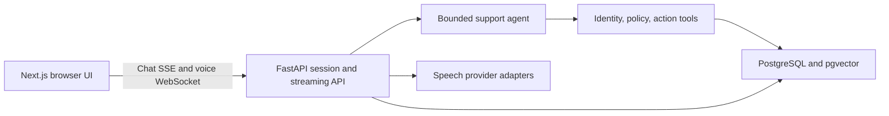
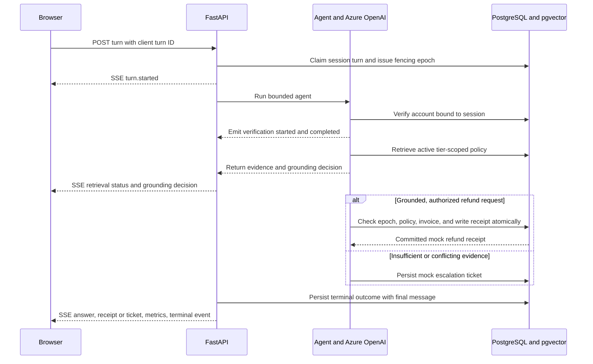
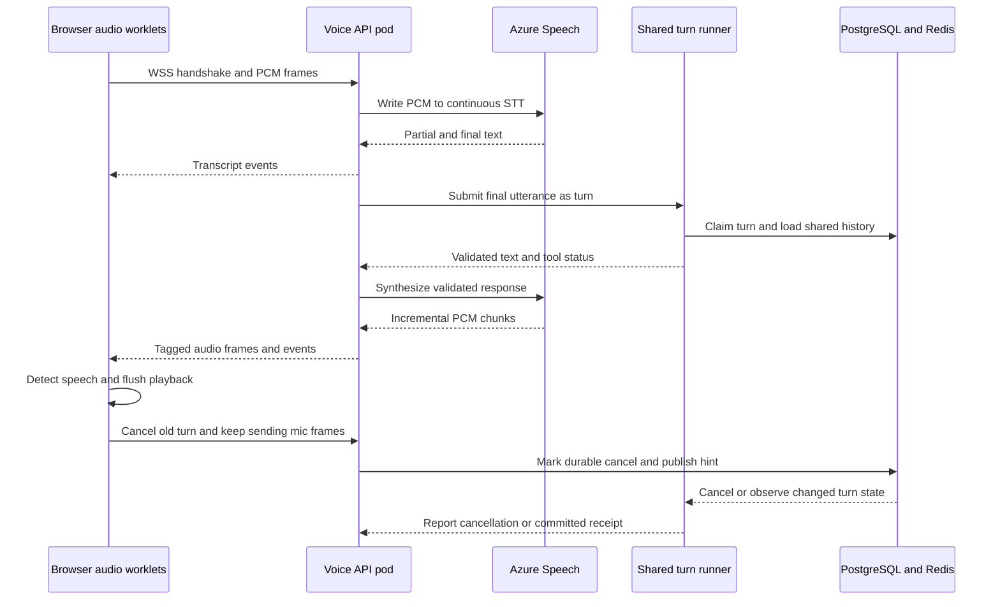
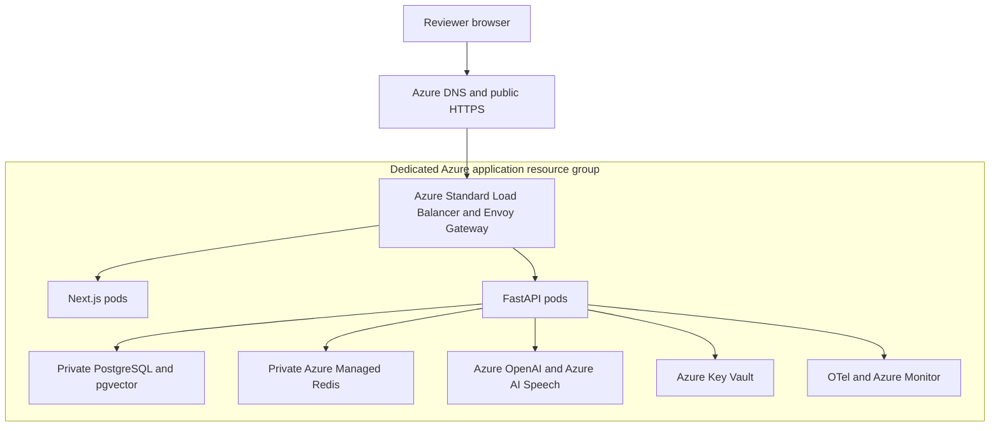
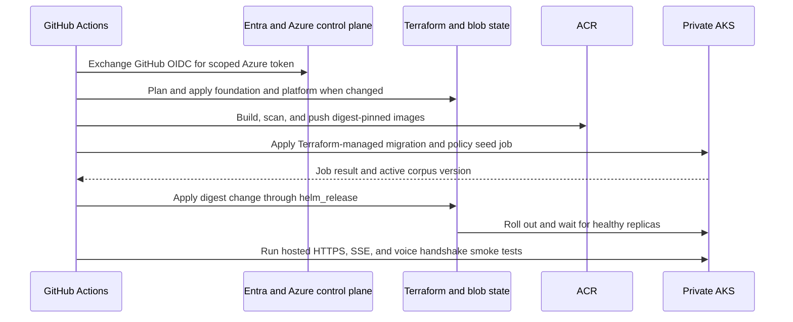
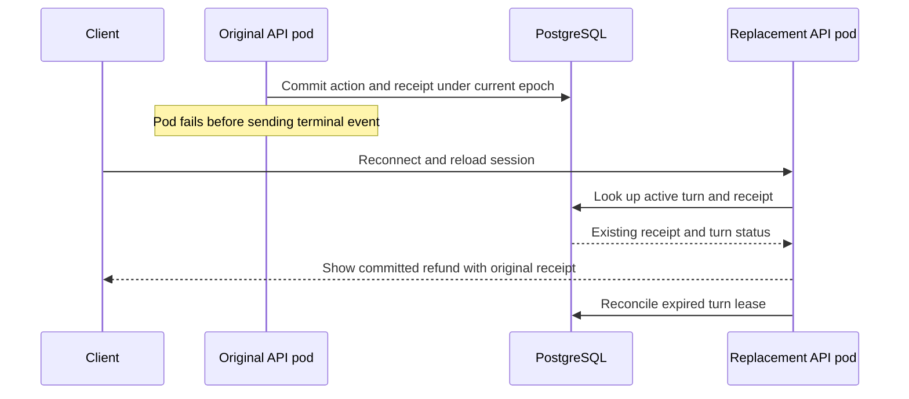

# Customer Support AI Agent
## Technical assessment handoff for Codex or Claude Code

Build and deploy a fullstack prototype that answers support questions in streaming chat and live voice, carries context between modes, and safely completes a multi-step mock support action. A reviewer should be able to reproduce the main success, interruption, low-confidence, and failure scenarios without setting up customer accounts or supplying API keys.

### 1. Scope and priorities

| Assessment requirement | Implementation and evidence |
|---|---|
| Agent architecture and orchestration, 35% | Typed, bounded tool loop with identity verification, tier-scoped policy retrieval, and a simulated refund. Backend validates the sequence and policy. Show grounding, escalation, and tool status events. |
| Voice and streaming UX, 25% | Streaming chat, live microphone waveform, partial and final voice transcripts, incremental audio playback, interruption, and continuous conversation when switching modes. |
| Code quality and system design, 25% | Next.js/TypeScript frontend, FastAPI/Pydantic backend, orchestration, tools, retrieval, provider adapters, migrations, and focused tests. |
| Production readiness, 15% | Deployed HTTPS demo, rate and cost limits, redacted telemetry, bounded recovery, and a rehearsed walkthrough. |

**Required by the assessment:** all four areas above, a GitHub repository with source, .env.example and concise README, a live demo, and a 3–5 minute Loom with screen and webcam, submitted within seven days of receipt.

**Proposed implementation choices:** Next.js, FastAPI, PostgreSQL with pgvector, a custom typed state machine, a single achieved refund path, and a streaming STT → shared agent → streaming TTS pipeline. Sections 12–19 specify the libraries, Azure topology, and delivery pipeline. Record any necessary deviations in the README. Use synthetic customers and policies with no real billing or support integrations.

### 2. Architecture and ownership

- Frontend owns transcript rendering, live tool status, microphone permission, waveform, playback, interruption controls, and the collapsible observability drawer. Use one conversation view with a chat/voice toggle.
- API owns session access, event ordering, limits, cancellation, and persistence. Both transports invoke the same turn runner. Provider SDKs stay behind interfaces for text generation, embeddings, streaming speech recognition, and speech synthesis.
- PostgreSQL stores sessions, messages, tool runs, refund receipts, escalation tickets, policy versions, and embedded chunks. Keep live socket and playback state local to the connected pod. Coordinate turns, cancellation, and duplicate requests across replicas as specified below. Persist final turn outcomes and action receipts. After reconnect or restart, reload session history and reconcile any abandoned turn with committed actions.
- Serve one HTTPS origin from Azure Kubernetes Service (AKS). The production topology and infrastructure ownership are in sections 15–17.
- Follow the repository layout in section 12. Generate typed event contracts across Python and TypeScript.

### 3. Demo fixtures and product behavior

Seed independently resettable demo accounts within each browser session. A clearly labeled simulated sign-in or verification code should bind a seeded account to the session. Never treat a chat message claiming an account or tier as proof of identity.

| Fixture | Expected result |
|---|---|
| Premium, active contract, recent paid invoice | A request for a $15 refund on the seeded $40 invoice succeeds under the sample $25 cap, with an eligible refund reason if the policy requires one. Show a receipt and a cited policy. |
| Basic, active contract | The same request is denied with the Basic policy cited. Seed a $10 cap to demonstrate tier-specific retrieval. |
| Premium, inactive contract | Deny the action and show the relevant contract restriction. |
| Unsupported or conflicting policy request | Enter human escalation with a reason and ticket reference. Show that the ticket is simulated. |
| Missing details or unverified account | Ask a targeted clarification or request demo verification. Resume after the missing input arrives. |
| Injected tool or provider failure | Show a visible recovery state and a safe retry path. Keep previously committed receipts visible. |

Use a small set of versioned Markdown policies covering refunds, contract eligibility, and troubleshooting. Include deliberately similar policies for different tiers, and hold out an unsupported topic such as shipping hardware to a new address. Illustrative fixture amounts are product choices for the demo.

### 4. Agent, tools, and action safety

Implement a typed state machine with model-selected next steps from the tools allowed in the current state. The runtime controls prerequisites and terminal states; no tool can be invoked out of order. The happy-path refund run shows these three separate calls within a turn after the user provides the required details:

1. `verify_identity` resolves the account bound to the session and returns verified customer ID, subscription tier, and contract status. Keep the demo verification secret out of model context and traces.
2. `retrieve_policy` takes the verified tier from server state, detects the policy topic, and returns authorized chunks, source references, and the grounding decision.
3. `execute_mock_refund` validates the authorized account, invoice ownership, currency, requested amount, remaining refundable balance, contract eligibility, and active policy constraints. Use integer minor units. The action service uses structured, versioned policy rules with matching source references. Test consistency between fixture rules and the text shown to the user.

Keep model-supplied arguments schema-validated. Require clear user intent and exact invoice and amount before committing. A question about eligibility or a request with ambiguous financial details should not execute an action. Use structured terminal outcomes for grounded answer, clarification, policy denial, action success, escalation, cancellation, and recoverable failure.

Emit tool start/completion/error events with safe summaries. Cap the loop at five tool invocations per turn by default, use explicit provider and tool timeouts, and end with a useful message if the budget is exhausted. Treat customer input and retrieved content as untrusted data. Tool permissions and account values come from server state.

Persist refund writes, balance updates, and receipts atomically. Give each user-requested action a stable intent ID spanning retries. Enforce receipt uniqueness by intent ID and lock the invoice while checking remaining balance. A lost response triggers a lookup by intent ID before any retry. A new, explicitly requested partial refund gets a new ID. Cancellation before commit should prevent the write where possible. A commit racing with cancellation is reported from its durable receipt. Never say a refund succeeded without a receipt.

Escalation uses a structured mock ticket with session reference, reason code, safe context summary, and citation references when available. If ticket creation fails, show that escalation is needed and ticket creation can be retried. Never invent a ticket ID.

### 5. Retrieval and confidence

1. Split Markdown by headings and retain document ID, version, heading path, effective status, applicable tiers, and stable chunk ID. Start with a soft size target of roughly 300 tokens and an overlap of up to 50 tokens for oversized sections. Preserve eligibility rules and their exceptions together where practical and retain short sections intact. Reindex deterministically when the document or embedding model changes. Exclude superseded versions from live queries.
2. Embed policy chunks and queries with the same configured model. Filter by authorization, active version, and verified tier plus explicitly global policies before ranking. Retrieve the top five using cosine similarity as a starting configuration. General public troubleshooting can use global policies.
3. Apply a configurable minimum similarity threshold calibrated on labeled fixture queries. Define the score direction and conversion explicitly so distance cannot be mistaken for similarity. Similarity measures retrieval relevance. Record evidence coverage separately and use a bounded verification step for eligibility, limits, and exceptions when needed. Conflicting evidence, missing coverage, or a failed verification should fail closed for policy claims and actions.
4. Build the answer from accepted chunks and cite document title, section, and version. Validate cited IDs against the accepted evidence. For policy-bearing turns, stream status first, then release grounded text after validation. Keep response length short for voice. Use deterministic confirmations for action receipts and escalation tickets.
5. Keep a small labeled evaluation set with supported paraphrases, tier overlap, near-threshold ambiguity, conflicting rules, and clear out-of-scope questions. Record selected threshold, supported-query acceptance, and unsupported-query rejection. Tune on a subset and check held-out examples. No universal numerical cutoff is assumed.

### 6. Session and streaming contracts

| Interface | Contract |
|---|---|
| `POST /api/sessions` | Create a demo session and issue an opaque session credential. Session identity and fixture profiles are bound on the server. |
| `GET /api/sessions/{id}` | Load chat and voice history, active turn status, and durable receipts/tickets for the authorized session. |
| `POST /api/sessions/{id}/turns` | Accept chat input and client turn ID. Return SSE via a streaming fetch. Duplicate IDs must not restart an action. |
| `WS /api/sessions/{id}/voice` | Receive microphone frames and control messages, return partial/final transcripts, common turn events, and framed audio identified by turn. Specify negotiated audio format in the handshake. |
| `POST /api/sessions/{id}/turns/{turnId}/cancel` | Cancel the targeted turn idempotently. Voice can send the same operation as a socket control event. |
| `GET /healthz`, `GET /readyz` | Expose process liveness and readiness for required dependencies without making billable provider calls. |

Common event envelope includes `version`, `session_id`, `turn_id`, per-turn monotonic `sequence`, `type`, `timestamp`, and a typed payload. Event types include `turn.started`, `transcript.partial`, `transcript.final`, `tool.started`, `tool.completed`, `tool.failed`, `grounding.decided`, `answer.delta`, `action.committed`, `turn.metrics`, and one terminal `turn.finished` with an outcome. SSE sends heartbeat comments during idle periods. On reconnect, reload the snapshot and use the existing turn ID for reconciliation. Full event replay is optional.

Use one active agent turn per session, enforced server-side. A modality switch preserves committed messages and verified account state. When switching while a reply is active, cancel the old generation before processing new input. Only final user transcripts become conversation turns. Keep a bounded recent history and structured state for account facts, pending clarifications, and action receipts. Discard interrupted assistant drafts from future model context and show them as interrupted in the UI if retained for display.

### 7. Live voice and interruption

- Start voice with an explicit user gesture. Capture mic samples, render a local waveform, and stream frames to STT. Keep interim transcripts visually distinct from final text. End the turn on provider or local voice activity detection with a manual end-turn fallback. Keep the microphone listening during playback with echo cancellation where available.
- Run final transcripts through the shared agent. Send verified response sentences to streaming TTS and begin playback as frames arrive. Render playback activity and show opt-in microphone state. Release media tracks and queued audio when voice mode closes.
- On new speech during playback, immediately stop local output and clear the audio queue. Send a cancel event for the prior turn, propagate cancellation through generation and TTS, and discard late events and audio for that turn. Continue capturing the interrupting utterance. A visible Stop button invokes the same cancellation behavior.
- Test in Chrome with speakers or a headset. Measure speech-end-to-first-audio and interruption-detection-to-local-stop separately. Initial demo targets are under 4 seconds to first audio for a simple grounded question and under 250 ms to stop locally after interruption detection. Report measured results with browser, provider, and number of runs. Treat the targets as tuning goals.

### 8. Observability, resilience, and public demo controls

The collapsible drawer shows a per-turn waterfall for STT, verification, retrieval, generation, and TTS when applicable. It also shows end-to-end latency, time to first visible text or audible audio, redacted prompt templates or rendered excerpts, model/provider name, tool transitions, grounding scores and threshold, input/output tokens where reported, and estimated cost. Track voice duration or billable units when available. Store pricing inputs and their date in config, label missing usage as unavailable, and label cost as an estimate. Keep hidden model reasoning, credentials, verification codes, raw audio, and sensitive account data out of traces.

| Failure | Expected behavior |
|---|---|
| LLM timeout or upstream rate limit | Bound retries to the turn deadline for transient read-only requests. Show a helpful message and retry control. Respect upstream retry timing within the budget. |
| Retrieval or verification unavailable | Stop policy-dependent actions. Offer escalation or a retry and preserve history. |
| Action timeout after possible commit | Reconcile the action by intent ID. Return the existing receipt if committed. Show a pending confirmation state while the result is unresolved. |
| Mic denied, STT/TTS fails, or voice disconnects | Explain the voice issue in place. Offer chat in the same session and allow voice reconnect. |
| SSE disconnect or browser refresh | Reload persisted session state and recover final answers or receipts without duplicate turns. |

Apply capped request sizes, turn/voice duration limits, per-session and per-IP rate limits, and a global concurrency/cost budget. Return controlled rate-limit responses and tell the user when to retry. Keep API keys server-side. Use secure opaque session cookies or equivalent short-lived credentials, origin validation for WebSockets and browser requests, and authorization on all session reads. Limit demo data retention, avoid raw microphone persistence, and document reset behavior. Make fault injection demo-only and scope it to the caller's own session.

### 9. Definition of done

- **Chat:** Send a multi-turn policy request and see live tool states, streamed answer, citations, and metrics.
- **Refund:** Demonstrate all three calls in order. Change accounts and verify the same amount is denied for Basic or inactive accounts. Simulate duplicate requests and a lost response without issuing a second refund.
- **Grounding:** Demonstrate an unsupported query, a near match, and a policy conflict. Each follows the configured decision path without an unsupported policy claim or action.
- **Voice:** Ask a question by mic, see waveform and live transcripts, hear the reply begin, interrupt it, and receive a reply to the new utterance. Switch to chat and refer back to the voice exchange.
- **Recovery:** Inject a mid-chain failure and provider timeout or rate limit. Verify clear feedback, session continuity, and a safe retry. Refresh or reconnect after a committed refund and verify the same receipt.
- **Isolation:** Two sessions cannot read each other's transcripts, traces, or receipts. A user-supplied tier or instruction in a retrieved document cannot override tool rules.
- **Verification:** Use deterministic provider fakes in CI for state transitions, guards, stream events, and cancellation. Use a PostgreSQL integration test for idempotency and balance checks. Run a recorded manual hosted browser smoke test with real speech, a fresh session, and clean reviewer access. Record limitations in the README.

### 10. Assessment milestones

Sections 12–18 expand these milestones into an Azure implementation plan.

| Day | Exit criterion |
|---|---|
| 1 | Repo, typed contracts, fixture schema, public skeleton, and voice transport spike proving microphone → transcript → audio with cancellation. |
| 2 | Versioned chunking and ingestion, tier-filtered retrieval, grounding evaluation set and baseline. |
| 3 | Three-tool refund path, policy denials, escalation, persistent state, and duplicate-write tests. |
| 4 | Streaming chat UI, voice integrated with the shared turn runner, waveform, transcripts, and interruption. |
| 5 | Trace drawer, usage/cost estimates, failure modes, and deployed end-to-end checks. |
| 6 | Reviewer-mode polish, guardrail calibration, fault tests, documentation, and rehearsal. |
| 7 | Hosted smoke test and recording buffer. Verify repository access, live URL, Loom playback, and submit the three links. |

Prioritize the end-to-end refund, voice interruption, and grounded fallback ahead of extra actions, decorative UI, or additional providers. Deploy multiple replicas for the hosted prototype and verify cross-pod cancellation and reconnection.

### 11. Submission checklist

- **GitHub repository:** full source, pinned dependencies, migrations, fixture seed and ingestion instructions, tests, and `.env.example`. Include placeholder variables for database connection, provider models/credentials, grounding threshold, timeouts, limits, allowed origins, and cost rates. README covers startup, architecture, chunking, calibration, error recovery, demo scenarios, known trade-offs, and measured latency. Confirm reviewers have access if private.
- **Live demo:** stable HTTPS URL, easy-to-find demo account controls, clear synthetic data labels, reviewer-ready microphone access, and seeded fixtures. Confirm from a clean browser session.
- **Loom, 3–5 minutes:** use screen and webcam. Suggested 4-minute run: 0:00–0:30 overview, 0:30–1:30 chat refund and three live tool events, 1:30–2:30 voice with interruption and shared chat history, 2:30–3:15 unsupported query and failure handling, 3:15–4:00 retrieval, threshold, traces, and trade-offs.
- **Email:** reply to the Careers Team within seven days of receiving the assessment with the GitHub, live demo, and Loom links.

### 12. Implementation stack and module boundaries

| Component | Use | Implementation contract |
|---|---|---|
| Web app | Next.js App Router, React, TypeScript, pnpm, Tailwind CSS, Radix Dialog/Collapsible | Standalone container build. Client components own streams and audio. Render the transcript and drawer from a typed reducer keyed by turn ID. Use accessible keyboard controls, status text, and an explicit mic indicator. |
| Web transports | Native fetch with `eventsource-parser`, WebSocket, AudioWorklet, Web Audio API, Canvas | Abortable SSE POST with event parsing across chunk boundaries. Binary PCM frames plus JSON controls over WSS. Canvas waveform driven locally via requestAnimationFrame. |
| API | Python 3.12, FastAPI, Uvicorn, Pydantic v2, pydantic-settings, uv | One async Uvicorn process per pod initially. Separate chat and voice transport adapters over the same application services. Limit queues and propagate cancellation. |
| Agent and LLM | Typed custom state machine, official `openai` Python SDK, `azure-identity` | Use `AsyncOpenAI` against Azure OpenAI v1 with Entra authentication and a configurable deployment. Start with GPT-4.1 mini or an available supported equivalent. Structured outputs for decisions and citation IDs. |
| Voice | `azure-cognitiveservices-speech`, Azure AI Speech | Continuous recognition with PushAudioInputStream. Relay SDK events into asyncio via thread-safe callbacks. Use synthesizing callbacks to forward incremental PCM output. Place blocking SDK waits and cleanup off the event loop. |
| Retrieval | `markdown-it-py`, `tiktoken`, `pgvector`, Azure OpenAI embeddings | Heading-aware chunking, configurable `text-embedding-3-small` deployment, fixed configured dimensionality with a database check, exact cosine search for the fixture corpus. |
| Persistence | SQLAlchemy 2 async, psycopg 3, Alembic, PostgreSQL Flexible Server | Explicit transactions for turns and actions. Operational, read-only retrieval, and migration database permissions separated. |
| Limits and cancel hints | `redis.asyncio`, Azure Managed Redis | Atomic rate limits and concurrency tokens with expiries. Pub/Sub accelerates cancellation. PostgreSQL remains authoritative for cancel intent, session fencing, and action receipts. |
| Tracing and metrics | OpenTelemetry SDK and FastAPI instrumentation, OTLP Collector, Azure Monitor/Application Insights, managed Prometheus | Correlate request, turn, provider, and tool spans. Client drawer uses the API's redacted per-turn projection. Publish operational metrics and alerts separately from user traces. Validate exporter connectivity on the hosted spike. |
| Test and quality | pytest, pytest-asyncio, HTTPX, PostgreSQL/Redis service containers, Ruff, mypy, Vitest, Playwright, k6 | Exercise state, real SQL transactions, binary fixtures and SSE, two browser contexts, and distributed failure. Voice fixtures feed prerecorded synthetic PCM. Also test real speaker/mic barge-in manually. |
| Deployment | Docker Buildx, Azure Container Registry, AKS Standard, Envoy Gateway, cert-manager, Terraform AzureRM/AzAPI/Helm/Kubernetes providers, GitHub Actions | Pin package and provider versions and release action SHAs. AzureRM first, narrow AzAPI resources only for missing capabilities. Terraform owns cluster platform and application releases. |

Use `apps/web`, `apps/api`, `contracts`, `fixtures/policies`, `deploy/charts/support-agent`, `infra/{bootstrap,foundation,platform,release}`, and `.github/workflows`. Keep provider adapters under `apps/api/support/providers`, orchestration and guardrails under `agent`, and durable turn/action logic under `storage` and `tools`. Generate JSON Schema from Pydantic models and TypeScript types from that schema in CI. Define migration and release jobs separately from the Deployment containers.

### 13. Chat, RAG, and transactional action sequence

- **Ingestion job.** Parse heading hierarchy, split by token budget, derive chunk IDs from policy version and normalized text, batch embeddings with bounded concurrency, and record the corpus checksum and embedding deployment. Stage the new corpus before an atomic activation. If a job crashes, the previously active corpus remains available. Retain compatible prior versions for outstanding receipts. Rebuild into a separate corpus when embedding dimensionality changes.
- **Retrieval.** Index active-version and tier predicates. For the small fixture set, filter rows before sorting by cosine distance. Convert distance to similarity with `1 - distance`. Add HNSW only after measuring recall and slow queries against the exact baseline with tier filters in place. Capture accepted chunk IDs and policy version before generation. Enforce grounding ahead of any refund action and validate output citations before emitting policy claims.
- **Policy execution.** Use a table or validated fixture ruleset keyed by policy version, tier, and action. Enforce expiry, invoice ownership, bounds, and contract eligibility inside the database transaction. Lock the session row then invoice row in a consistent order. Recheck cancellation and epoch at commit. Use unique constraints for `(session_id, client_turn_id)`, action intent, and ticket intent. Hash normalized input for duplicate turn IDs and reject conflicting reuse.
- **Output.** Begin with progress events while validating sensitive claims. Interrupting an answer may discard displayed draft text. Durable receipts and terminal turns remain recoverable from any replica. Track status order via an incrementing per-turn sequence. For mid-turn disconnect, retrieve a snapshot and reconnect voice; use bounded durable milestone events if a richer replay becomes necessary.

### 14. Voice transport and cross-replica cancellation

- Capture at browser-native sample rate, resample to 16 kHz, and transmit mono signed PCM16 LE in 20 ms frames. Negotiate a fixed TTS format such as 24 kHz mono PCM16 LE. Tag downlink frames with a numeric stream ID mapped to the turn ID in a JSON event. An AudioWorklet plays a bounded ring buffer with sample-rate conversion and clears it immediately on interruption. Keep capture and playback independent.
- Use energy-based onset detection with a short debounce and echo cancellation for immediate local barge-in. Keep a short microphone pre-roll for onset boundaries. Use the recognizer's final speech result or manual end-turn to start the next turn. Keep the user-visible Stop control. Ignore old stream IDs after a flush, even if provider buffers deliver late frames. Measure speaker echo false positives and headset behavior.
- Keep maximum frame size, queues, socket send backlog, and voice session lifetime bounded. Treat prolonged backpressure as a recoverable voice transport error and offer reconnect or chat. Record first partial, speech end, first audio bytes, browser playback start, and interruption-to-stop using local clocks for client-only spans.
- **Multi-pod turn ownership.** Store active turn ID, owner heartbeat deadline, monotonic fencing epoch, and cancellation flag in PostgreSQL. Claim/renew with a conditional transaction. Start with a 15-second lease and renewal every 5 seconds. Renew only while serving the turn. On pod loss or lease expiry, a reconciler claims expired records in batches using `FOR UPDATE SKIP LOCKED`, finds committed receipts, and marks orphaned work recoverable. Stale owners cannot commit messages or actions. Persist cancellation before publishing; owners periodically check durable state so Pub/Sub drops cannot defeat cancellation. An incoming turn waits for the prior owner's terminal state or returns a recoverable busy result. Live media reconnects on a fresh pod and reloads state.

### 15. Azure topology and resource ownership

| Area | Terraform decision |
|---|---|
| Environments | Default to East US 2, contingent on AKS quota, Speech and model capacity, Redis SKU and HA availability. Keep regions configurable by service. Use `rg-support-agent-demo-eus2`, a separate production environment/state if commissioned, Azure's AKS-managed node resource group, and a separate protected bootstrap/state resource group. Tag ownership, environment, cost center, and expiry. |
| Networking | VNet with AKS, private endpoint, delegated PostgreSQL, and trusted runner subnets. Use Azure CNI Overlay with network policy; size pod and service CIDRs for maximum nodes and avoid overlaps. Use NAT Gateway for predictable egress. Private DNS zones and VNet links for managed private services. Private AKS control plane with Entra RBAC and local accounts disabled. |
| Ingress | Install Envoy Gateway and Gateway API CRDs with Terraform-managed Helm. Public Standard Load Balancer fronts Envoy. Route `/api` to FastAPI and `/` to Next.js through HTTPRoute. Azure DNS + cert-manager DNS-01 issue TLS for an owned, delegated domain. Provision a stable Azure public IP and bind it to the Envoy Service. Confirm unbuffered SSE, WebSocket upgrade, idle behavior, and health probes on the public endpoint. |
| AKS compute | Separate system and user pools. Use zone-spread nodes where supported, cluster autoscaler and metrics-server. Start demo with two web and two API replicas and capacity across distinct nodes. Production profile uses three API replicas and three-zone placement where available. Size with load tests. |
| Container registry | ACR Premium with private endpoint for the private deployment path; use VNet DNS from CI and kubelets. Separate push identity and kubelet pull identity. Grant AcrPush/AcrPull for standard registry RBAC or equivalent repository writer/reader roles for ABAC mode. Deploy image digests. |
| Data services | PostgreSQL Flexible Server with private access, pgvector allowlist, backups/PITR, and zone-redundant HA in the production profile. Use TLS with certificate validation. Configure Azure Managed Redis private endpoint, TLS, and production HA SKU. Redis data is replaceable coordination data. |
| AI and secrets | Terraform provisions Azure OpenAI and Speech resources and deployments where capacity permits. Configure private endpoints where the selected service, SDK, and endpoint configuration support the path, then test those routes from AKS. Use a workload identity per service account with scoped provider and Key Vault access. For any required SDK secret, seed Key Vault out of band and fetch at runtime; Terraform manages the vault and grants, not secret values. |
| Telemetry | Log Analytics, workspace-backed Application Insights, Azure Monitor workspace, managed Prometheus, dashboards and alerts. Provision action groups, budgets and log retention with Terraform. Set trace sampling and redact before export. |

Use PostgreSQL Entra authentication where practical: create app, retrieval and migration principals through a private one-time admin bootstrap job scripted in the repository, then refresh tokens when establishing new database connections. Keep the app principal out of schema administration. Workload Identity federation binds each service account subject to its own managed identity; Azure roles and database grants are provisioned independently.

### 16. Terraform state and GitHub Actions deployment

Separate states and permissions to avoid a first-run dependency on an AKS cluster that Terraform has yet to create.

| Terraform root | Owns | Execution and dependencies |
|---|---|---|
| `infra/bootstrap` | State storage, dedicated state containers, initial Azure identities/federation, root role assignments, runner bootstrap configuration as applicable | One-time authorized operator uses Terraform and migrates bootstrap state into the remote backend. A pre-existing subscription, domain delegation and sufficient permissions are prerequisites. State account and initial OIDC trust exist before CI can use them. |
| `infra/foundation` | Dedicated workload RG, network/DNS, private runner VM or pool, ACR, AKS, databases, AI, Key Vault, Azure monitoring and runtime role assignments | First foundation apply runs from a trusted hosted workflow with access to the state backend and Azure management plane. Private service data-plane work waits until the runner is reachable. Subsequent applies from the trusted private runner. |
| `infra/platform` | Namespace, service accounts, Pod Security labels, Gateway API CRDs/controller, gateway/listener and cert-manager, shared monitoring config | Private runner after AKS exists. Install CRDs before planning CRD-backed manifests; split controller and custom-resource applies into ordered state roots if the Kubernetes provider needs discovery at plan time. |
| `infra/release` | Terraform `helm_release` for application deployments, HTTPRoutes, HPAs, PDBs, policies, and digest-pinned app configuration | Private runner after schema/index jobs succeed. Helm waits for readiness and rolls back a failed release. Application rollback also uses Terraform with previous digests. |

Use a remote `azurerm` backend with Entra data-plane auth, OIDC, native blob locking, blob versioning and soft delete. Separate containers/state keys and scope state permissions by environment/root. The initial access path must match runner placement. Use a protected state endpoint accessible to an enrolled runner, or enable Entra-only endpoint access for the first managed bootstrap and restrict it once private runner access is confirmed. Disable storage shared-key auth. Treat state and saved plans as sensitive. Use locking and workflow concurrency to serialize per-environment deployment. Disallow accidental production deletion with resource protections and a plan gate that checks destructive/replacement changes.

**Workflow implementation**

1. **`pr.yml`** runs on GitHub-hosted runners without Azure write access. Run lint/typecheck, unit and integration suites, contract drift checks, `terraform fmt -check`, `validate`, Helm lint, and Trivy scans. Never run untrusted PR code on a privileged private runner. Run authenticated plans only for trusted revisions with scoped Azure read access and access to the relevant state.
2. **`deploy.yml`** runs on protected `main` merges. Use per-environment concurrency with cancellation disabled for applies. Authenticate via `azure/login` and `id-token: write`. Entra federated credentials match the GitHub environment subject. Use separate apply, image push, and Kubernetes release identities. Scope the foundation identity to the app RG and narrowly scoped exceptions for bootstrap and approved role definitions. Pass AKS credentials through Entra and use namespace-scoped access for releases. Platform setup has separate permissions for cluster-wide CRDs.
3. **Plan and apply automatically.** In each stage, initialize the matching state, generate and validate a saved plan for the same commit, then apply that exact plan. Keep plans on the trusted runner or use restricted, short-lived storage. Apply safe changes automatically after merge. Route destructive infrastructure changes through an explicit protected exception. Use settings and outputs to pass resource IDs and digests. Avoid exposing plan contents or credentials in logs.
4. **Private runner connectivity.** Provision a dedicated runner VM or pool and networking with Terraform. Enroll it once using a short-lived GitHub registration credential supplied outside Terraform state. Restrict it to protected deployment workflows and allow outbound GitHub traffic. It reaches private AKS, ACR, state, and deployment dependencies. Validate DNS before the first release. Never give the VM a standing subscription-wide identity. Document the initial control-plane apply and runner registration commands.
5. **Release gates.** Build candidate images, scan them, and store the immutable digests. Run versioned Alembic and corpus-ingestion Kubernetes Jobs from a Terraform-managed release prep stage with a deadline, a bounded retry count, and explicit completion checks. Use backward-compatible expand/contract migrations for overlapping rollouts. Apply the Helm release through Terraform only after prep succeeds. Validate health, chat refund, streaming cancellation and voice handshake through the public URL. Run a browser canary for audio before recording the demo.
6. **Rollback and drift.** Roll back by applying the last known-good digests/config through Terraform. Helm failure rollback protects rollout readiness; failed external smoke triggers a separate rollback job against the previous tested release manifest. Database schema downgrades are a separate recovery decision. Persist a release manifest of images, migrations and corpus versions. Run a scheduled read-only drift plan and report changes. Timestamp pipeline evidence and retain commit SHA in the app.

### 17. Load balancing, failure handling, and operating targets

- **Balance and scale.** Envoy spreads new requests across ready pod endpoints. Established SSE and WebSocket connections stay on their owning pod. No sticky sessions. Use CPU HPA initially, then add an API custom metric for active WebSockets and active turns via Prometheus Adapter. Validate the metrics API before enabling custom autoscaling. Set resource requests, per-pod capacity caps, scaling stabilization, cluster autoscaler bounds, and provider concurrency limits. Load test idle sockets and active STT separately.
- **Drain.** Use readiness and startup probes, PodDisruptionBudgets, topology spread, and rolling updates with `maxUnavailable: 0` where there is spare capacity. Start a drain on preStop, mark the pod unready, decline new turns, and finish short in-flight work or tell clients to reconnect. Bound the drain window and set termination grace longer than the drain. Test rollout and node drain while a voice turn and a refund are running.
- **Database and outage recovery.** Cap per-pod pool sizes against max replicas, leave room for migrations, and consider PgBouncer after measurement and a transaction-semantics check. HA failover can break existing connections. Reconnect with jitter, retry idempotent reads within deadline, and reconcile writes by intent. Restore backups into an isolated instance and replay a smoke test. Production expansion may add a second regional deployment and warm database standby after defining and testing regional RTO/RPO.
- **Redis degradation.** Durable cancellation checks and action fencing continue. If shared admission control is unavailable, fail closed for new billable turns and keep existing history accessible. Alert on Redis errors, exhausted provider quota, and stale lease reconciliation.
- **Timeout budgets.** Begin with read/tool deadlines and a 30-second chat-turn budget. Align Gateway route and stream idle timeouts with the maximum supported stream life. Use SSE heartbeat comments and application WebSocket pings; test with the actual proxy chain. Cap voice duration and distinguish an idle socket from an active turn. Track upstream 429s, backoffs, provider timeouts, and reconnects.
- **Measure.** Initial load-test profile is 50 concurrent chat clients and 20 voice sockets, including a smaller active-speech cohort within quota. Capture p50/p95 first text and audio, tool durations, cancel latency, 5xx rate, pending refunds, stuck leases, pod CPU/memory, DB connections, and provider saturation. Aim for p95 first visible tool status under 1 second and voice targets in section 7. Verify no duplicate action under a rollout, retry burst, or injected pod kill. Treat capacity and availability targets as provisional until verified.
- **Security and access.** Keep client cookies Secure, HttpOnly and SameSite with appropriate CSRF/origin controls. Validate voice origin and cookie session. Keep egress and network policies explicit, run non-root images with a read-only root filesystem where practical, and exclude application secrets and raw voice from logs. Budget alerts are financial visibility; enforce separate application quotas for immediate spending controls.

### 18. Sprint execution and acceptance evidence

| Day | Parallel workstreams and exit criterion |
|---|---|
| 1 | Bootstrap Terraform/OIDC, check region quotas and DNS delegation, provision foundation and runner. Build an AudioWorklet → Speech → playback spike. Exit when the network and provider path is proven or exact capacity blockers are documented. |
| 2 | Platform Terraform and HTTPS deployment, API contracts, schema migration and corpus index. Exit with authenticated deployment on `main`, reachable health, WSS and unbuffered SSE. |
| 3 | Implement shared turn runner, grounding tests, tier-scoped refund and ticket, leases, retries. Exit with same-intent concurrent write test against PostgreSQL. |
| 4 | Integrate chat and voice, live statuses, barge-in, and history across modes. Exit with first live review rehearsal on Azure. |
| 5 | Add trace drawer, shared limits, monitoring alerts, HPA/PDB/drain config and release rollback. Run fault injection with two API pods and capture results. |
| 6 | Exercise node/pod drain, timeout, Redis loss, provider 429, duplicate refund, and clean browser reviewer access. Record measured numbers, restore approach, and operating limits. |
| 7 | Fix highest-risk rubric gaps, run the final pipeline, record Loom and verify all submission links. |

Keep the seven-day demo profile affordable with a narrow policy dataset and bounded quota. Codify production settings as a separate Terraform variable profile. Record exactly which HA, scaling, restore, and load tests ran; report the verified service limits alongside the demo results.

### 19. Official implementation references

- [Azure workload identity for AKS](https://learn.microsoft.com/en-us/azure/aks/workload-identity-overview), [GitHub Actions Azure OIDC](https://learn.microsoft.com/en-us/azure/developer/github/connect-from-azure), [Terraform Azure state backend](https://developer.hashicorp.com/terraform/language/backend/azurerm)
- [Envoy Gateway HTTP timeouts](https://gateway.envoyproxy.io/docs/tasks/traffic/http-timeouts/), [cert-manager Azure DNS solver](https://cert-manager.io/docs/configuration/acme/dns01/azuredns/), [ACR and AKS role selection](https://learn.microsoft.com/en-us/azure/aks/cluster-container-registry-integration)
- [Azure PostgreSQL pgvector](https://learn.microsoft.com/en-us/azure/postgresql/extensions/how-to-use-pgvector), [Azure PostgreSQL reliability](https://learn.microsoft.com/en-us/azure/reliability/reliability-database-postgresql), [AzureRM Managed Redis](https://registry.terraform.io/providers/hashicorp/azurerm/latest/docs/resources/managed_redis)
- [Azure OpenAI Entra authentication and Responses API](https://learn.microsoft.com/en-us/azure/developer/ai/get-started-securing-your-ai-app), [Speech push audio input](https://learn.microsoft.com/en-us/python/api/azure-cognitiveservices-speech/azure.cognitiveservices.speech.audio.pushaudioinputstream), [Speech synthesis events](https://learn.microsoft.com/en-us/azure/ai-services/speech-service/how-to-speech-synthesis)

### 20. Coding-agent kickoff

Start with a region/quota check and a minimal deployment containing one chat stream and one real voice round trip. Then complete the refund path and add distributed failure tests before expanding features. Keep infrastructure changes in Terraform, cluster releases in the Terraform-managed Helm delivery path, and reviewer steps in the README. Link the pipeline run, report measured behavior and deviations, and list any unverified acceptance criteria before submission.
